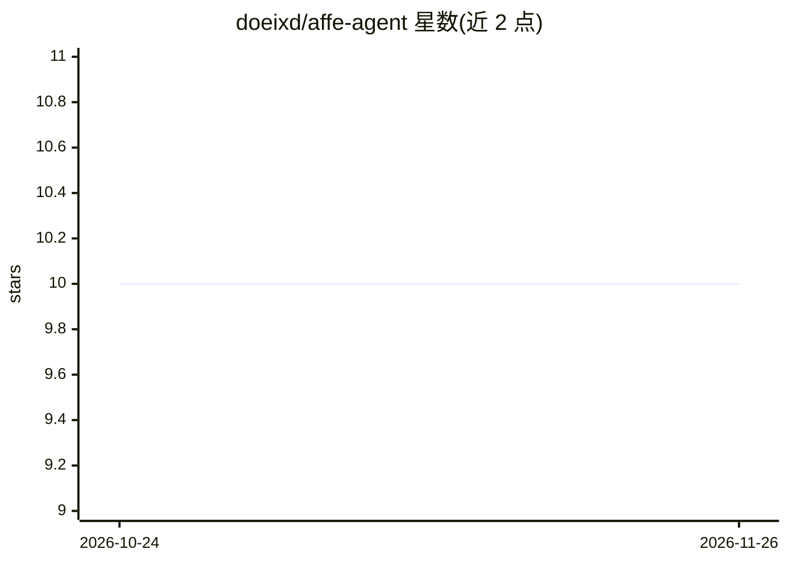

# doeixd/affe-agent

⭐ 10 · TypeScript · MIT · 推送 2026-09-27 · [GitHub](https://github.com/doeixd/affe-agent) · 个人维护

**面向 TypeScript 开发者的 Effect 原生 agent 执行内核**

构建在 Effect AI 之上的 agent 执行内核库，提供 sessions、runs、turns、steering、follow-ups、中断与类型化生命周期事件等通用层，应用代码通过多个可插拔 seam（toolkit、permission、loop、LanguageModel、Sandbox 等）扩展能力。模型由 @effect/ai-* provider 包在运行时注入，同一 agent 可对接任意 provider 或测试用脚本模型。当前为 0.0.1 pre-release，依赖 Effect 4 release candidate，版本需严格锁定。

## 筛选速览

| 维度 | 判定 | 备注 |
|---|---|---|
| AI 角色 | `ai-ecosystem` | LLM/agent 周边工具 |
| 许可风险 | `permissive` | MIT |
| 部署形态 | `library` | 以包/库形式分发 |
| 模型依赖 | locked-api |  |
| 硬件要求 | — | 无带数字的原话,不猜 |
| 安装摩擦 | `low` | 无编译、无系统依赖或容器化 |
| 成熟度 | `idea` | |

## 能力要点

- 提供 sessions→runs→turns 的执行内核与类型化生命周期事件
- steering（FIFO、turn 边界生效）、follow-ups、中断等会话控制机制
- 多个可插拔 seam：toolkit、permission、loop、LanguageModel、Sandbox、eventSink
- 传输适配层覆盖 HTTP、RPC、AG-UI、A2A、MCP、OpenAI 等协议

## 适用场景

- 在 Effect/TypeScript 技术栈中构建 coding、research、chat 类 agent 应用
- 需要会话历史、转向输入、预算与权限控制的 agent 运行时
- 用脚本化 TestLanguageModel 做 agent 的确定性测试

## 场景标签

`Agent 框架` · 领域:Agent 开发

## 证据(README 行号)

> L3: An Effect-native agent execution kernel.
> L10: That layer is all this library is.
> L119: |**`LanguageModel`**|`Layer`|the model provider|`@effect/ai-*`, `/model` metadata|

## 星数曲线

2026-10-24 10 → 2026-11-26 10（+0）

---
*卡片 v1 · prompt 1.4 · 生成 2026-11-19 · 置信度 high · 依据 README sha `b418fb3032cf` · [字段定义](../../DATASET.md)*
