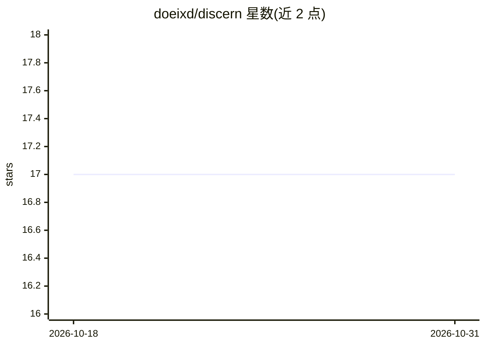

# doeixd/discern

⭐ 17 · TypeScript · MIT · 推送 2026-09-25 · [GitHub](https://github.com/doeixd/discern) · [官网](https://github.com/doeixd/discern#readme) · 个人维护

**Effect 之上的不确定性感知语义模式匹配与策略库**

TypeScript 库，构建在 Effect v4 的 Decision/DecisionModel 之上，提供三值语义模式匹配（Match/Uncertain/Miss）、可复用策略（Policy）、编译计划、追踪、重放与阈值校准（Discern.Eval.calibrate）。它将模型产生的分类、概率、评级等语义证据作为分支条件处理，收集策略所需决策并批量为一次 DecisionModel 调用。提供者中立：运行于 TypeSafe 的 Jev 或任意 DecisionModel。状态为 pre-1.0 早期不稳定，依赖 Effect v4 RC 版本。

## 筛选速览

| 维度 | 判定 | 备注 |
|---|---|---|
| AI 角色 | `ai-ecosystem` | LLM/agent 周边工具 |
| 许可风险 | `permissive` | MIT |
| 部署形态 | `library` | 以包/库形式分发 |
| 模型依赖 | — | README 未给出锁定关系 |
| 硬件要求 | — | 无带数字的原话,不猜 |
| 安装摩擦 | `low` | 无编译、无系统依赖或容器化 |
| 成熟度 | `idea` | |

## 能力要点

- 三值逻辑模式匹配，中间地带走 onUncertain 而非静默舍入
- 策略所需决策自动收集并批量为一次 DecisionModel 调用
- Policy 附带可序列化计划、runWithTrace 追踪与离线 replay
- 阈值错误（InvalidThresholdError/InvalidRangeError）在定义期抛出

## 适用场景

- 在 Effect 应用中用 LLM 判定结果驱动类型安全的控制流分支
- 对模型置信度处于中间带的输入路由到人工审核
- 录制并重放决策观测，做缓存、预算与阈值校准

## 场景标签

 · 领域:LLM 基础设施/类型安全控制流

## 证据(README 行号)

> L3: **Uncertainty-aware, smart semantic control flow and procedures for Effect.**
> L27: A normal pattern matches facts you can compute exactly. A Discern pattern
> L28: matches **semantic evidence** produced by a `DecisionModel`.

## 星数曲线

2026-10-18 17 → 2026-10-31 17（+0）

---
*卡片 v1 · prompt 1.4 · 生成 2026-10-30 · 置信度 high · 依据 README sha `adf156b63ca5` · [字段定义](../../DATASET.md)*
