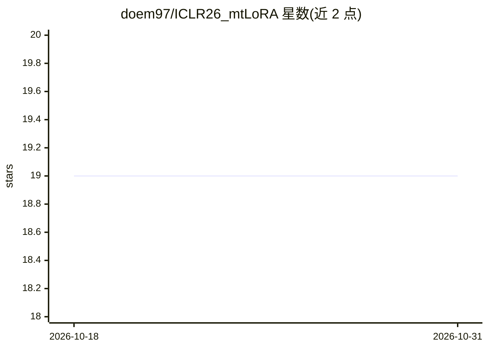

# doem97/ICLR26_mtLoRA

⭐ 19 · Python · 推送 2026-09-12 · [GitHub](https://github.com/doem97/ICLR26_mtLoRA) · [官网](https://www.doem1997.com/mtlora/) · 组织维护

**ICLR 2026 论文 mtLoRA 官方实现：可扩展多任务 LoRA 适配方法**

新加坡管理大学团队发表的 ICLR 2026 论文 mtLoRA 的官方 PyTorch 实现。方法针对多任务 LoRA 扩展到 15–25+ 任务时的性能崩溃，提出谱感知正则化、细粒度路由与块级适配三个设计，在 LLaMA-2-7B/13B 上训练与评测（BBH、MMLU）。提供 conda 环境文件、定制 PEFT 库、复现各表格与图表的脚本，并支持通过 Claude Code 一键复现实验。需 1–2 张 ≥16GB 显存 GPU。

## 筛选速览

| 维度 | 判定 | 备注 |
|---|---|---|
| AI 角色 | `ai-native` | 本体是模型或模型工具 |
| 许可风险 | `none` | — |
| 部署形态 | `library` | 以包/库形式分发 |
| 模型依赖 | — | README 未给出锁定关系 |
| 硬件要求 | `gpu-8g` | |
| 安装摩擦 | `medium` | 含编译或系统依赖之一 |
| 成熟度 | — | 结构信号不足 |

## 能力要点

- 三个核心设计：谱感知正则化、细粒度路由、块级适配
- 提供复现论文表格与分析图表的端到端脚本
- 支持 Claude Code AI Agent 读取 CLAUDE.md 自动复现实验
- 含自定义 PEFT 库与 CUDA 11.8/12.4 两套环境文件

## 适用场景

- 复现论文中 BBH/MMLU 多任务实验结果
- 基于代码开展多任务 LoRA/PEFT 研究与消融
- 在自有 LLaMA 模型上做多任务低秩适配训练

## 场景标签

`微调` · 领域:训练与推理

## 证据(README 行号)

> L37: Official implementation of **mtLoRA** (**m**ulti-**t**ask **LoRA**) from the paper **"Scalable Multi-Task Low-Rank 
> L62: NLP results on LLaMA-2-7B (reproduced by this codebase):

## 星数曲线

2026-10-18 19 → 2026-10-31 19（+0）

---
*卡片 v1 · prompt 1.4 · 生成 2026-10-28 · 置信度 high · 依据 README sha `483c278ac2a9` · [字段定义](../../DATASET.md)*
