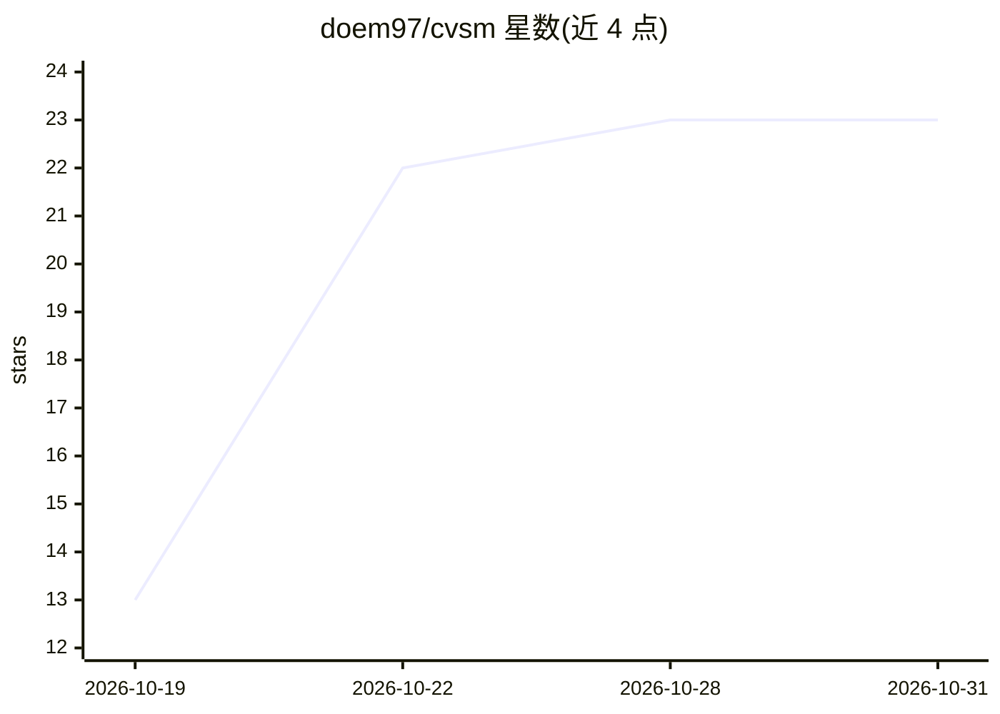

# doem97/cvsm

⭐ 23 · Python · Apache-2.0 · 推送 2026-10-30 · [GitHub](https://github.com/doem97/cvsm) · [官网](https://doem97.github.io/cvsm/) · 个人维护 · 中文 README

**用编码代理做受控 ML 实验的状态机协议（复制文件即用）**

CVSM 是一套复制进研究仓库的协议文件而非服务：研究者编写研究规格（study spec），声明各实验组的差异变量、固定变量与可自适应变量；Claude Code 或 Codex 编码代理通过 GitHub issues 与 PR 逐状态实施并运行实验。每条 run 记录其解析后的配置，脚本将其对照规格核验并报告不允许的差异。流程设四个人工闸口：publish、merge、budget、conclude。采用方式为复制 AGENTS.md、.agents/.claude/.codex 等文件并运行 setup.sh 配置仓库。当前为 v0.1.0 预发布，接口在 1.0 前可能变动。

## 筛选速览

| 维度 | 判定 | 备注 |
|---|---|---|
| AI 角色 | `ai-ecosystem` | LLM/agent 周边工具 |
| 许可风险 | `permissive` | Apache-2.0 |
| 部署形态 | `None` |  |
| 模型依赖 | — | README 未给出锁定关系 |
| 硬件要求 | — | 无带数字的原话,不猜 |
| 安装摩擦 | `low` | 无编译、无系统依赖或容器化 |
| 成熟度 | `idea` | |

## 能力要点

- 研究规格声明变量分层（差异/固定/可自适应），每条 run 对照规格自动核验
- 四个人工闸口：publish、merge、budget、conclude
- GitHub issues 持有状态，AGENTS.md 规则文件加四个技能承载流程，兼容 Claude Code 与 Codex
- setup.sh 一键配置 labels、squash-only 合并与分支保护

## 适用场景

- 让编码代理跑对照实验且保留人工审查节点
- 保证 ML 实验各臂的受控变量与规格一致、结果可复现
- 在 GitHub 上以 issues/PR 流程管理实验状态机

## 场景标签

`科研工具` `MLOps` · 领域:学习与行业

## 证据(README 行号)

> L5: A state machine protocol for running controlled ML experiments with coding agents. You write the study spec: which v
> L7: CVSM is a set of files you copy into a research repo, not a service. GitHub issues hold the state, and one rules fil

## 星数曲线

2026-10-19 13 → 2026-10-31 23（+10）

---
*卡片 v1 · prompt 1.4 · 生成 2026-10-28 · 置信度 high · 依据 README sha `0f5d636f6360` · [字段定义](../../DATASET.md)*
