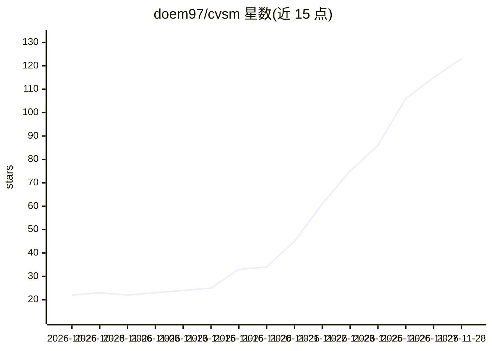

# doem97/cvsm

⭐ 123 · Python · Apache-2.0 · 推送 2026-11-25 · [GitHub](https://github.com/doem97/cvsm) · [官网](https://doem97.github.io/cvsm/) · 个人维护 · 中文 README

**让研究者用 coding agent 受控运行 ML 实验的状态机协议**

CVSM 是一组复制进研究仓库的文件（非服务）：研究者编写 study spec 说明各实验组哪些变量不同、哪些固定、哪些可自适应，coding agent 通过 GitHub issues 与 pull requests 逐步执行研究。流程经过 publish、merge、budget、conclude 四个人工门控，每次运行记录其 resolved config，脚本将其与 spec 比对并报告差异。支持 Claude Code 与 Codex 两类 agent，当前为 pre-release（v0.1.0），接口可能在 1.0 前变动。

## 筛选速览

| 维度 | 判定 | 备注 |
|---|---|---|
| AI 角色 | `ai-ecosystem` | LLM/agent 周边工具 |
| 许可风险 | `permissive` | Apache-2.0 |
| 部署形态 | `None` |  |
| 模型依赖 | — | README 未给出锁定关系 |
| 硬件要求 | — | 无带数字的原话,不猜 |
| 安装摩擦 | `low` | 无编译、无系统依赖或容器化 |
| 成熟度 | `idea` | |

## 能力要点

- 四个人工门控（publish/merge/budget/conclude）控制实验流程
- 每次运行的 config 记录与 study spec 自动比对，报告不允许的差异
- 以文件集合形式复制进仓库，GitHub issues 承载状态
- 同一套规则文件与技能同时适配 Claude Code 与 Codex

## 适用场景

- 用 coding agent 跑 ML 对照实验并保证可复现
- 对 agent 产出的实验配置做规格校验
- 在实验关键节点保留人工决策点

## 场景标签

`编码 Agent` `科研工具` · 领域:编码与开发

## 证据(README 行号)

> L5: A state machine protocol for running controlled ML experiments with coding agents. You write the study spec: which v
> L7: CVSM is a set of files you copy into a research repo, not a service. GitHub issues hold the state, and one rules fil

## 星数曲线

2026-10-26 22 → 2026-11-28 123（+101）

---
*卡片 v1 · prompt 1.4 · 生成 2026-11-28 · 置信度 high · 依据 README sha `b62def97e80b` · [字段定义](../../DATASET.md)*
