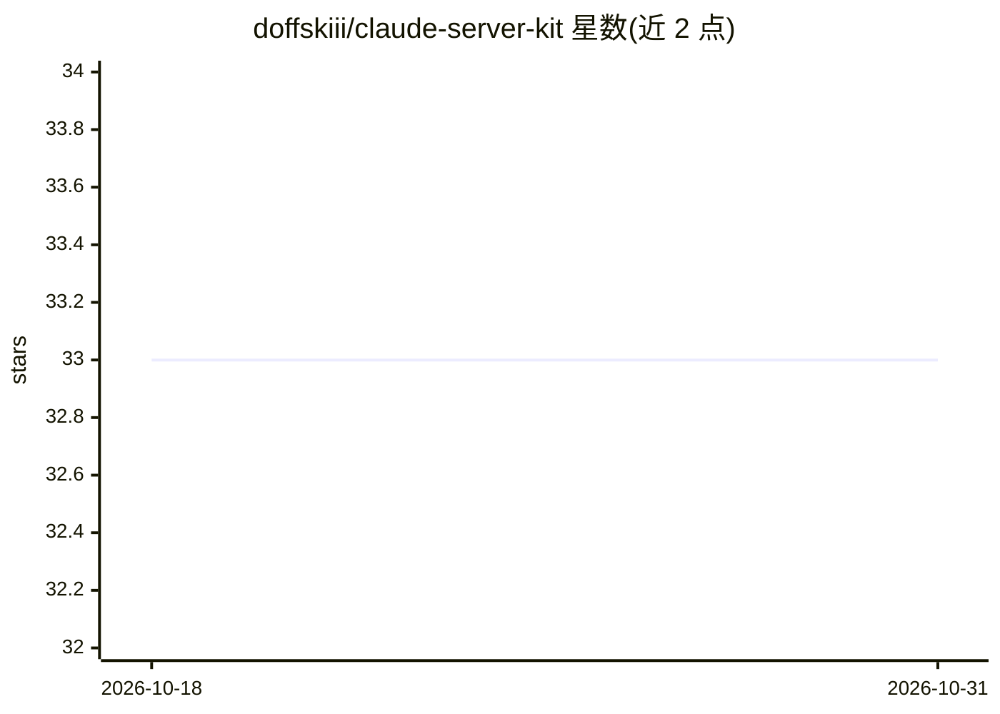

# doffskiii/claude-server-kit

⭐ 33 · Python · 推送 2026-06-25 · [GitHub](https://github.com/doffskiii/claude-server-kit) · 个人维护

**把 VPS 变成带记忆与 Telegram 的个人 AI 助手工具套件**

围绕 Claude Code 构建的个人服务器套件：克隆仓库并运行 setup.sh 后获得具备持久记忆、Telegram 机器人交互（Takopi）、Obsidian 知识库（git 同步、YAML 元数据、双向链接）、语音转写（短音频本地 Whisper、长音频经 Groq API）、语义搜索（CPU 上运行的 ONNX 模型）、日历与服务器监控的 agent 系统。核心机制包括 Brain MCP（20 个工具）、上下文压缩后规则重注入的 hooks、多层 CLAUDE.md 与定时任务用低价模型执行的 heartbeat 模式。要求 Ubuntu 20.04+ 与 2GB 以上内存（Whisper+嵌入需 4GB），setup.sh 自动安装 uv、Python 3.12+、Node.js、PM2、ffmpeg。README 为俄语。

## 筛选速览

| 维度 | 判定 | 备注 |
|---|---|---|
| AI 角色 | `ai-ecosystem` | LLM/agent 周边工具 |
| 许可风险 | `permissive` | — |
| 部署形态 | `None` |  |
| 模型依赖 | locked-api |  |
| 硬件要求 | — | 无带数字的原话,不猜 |
| 安装摩擦 | `medium` | 含编译或系统依赖之一 |
| 成熟度 | — | 结构信号不足 |

## 能力要点

- Brain MCP 提供 20 个工具：记忆搜索/写入、音频与文档摄取、日历、Telegram、服务器状态
- Obsidian vault 存储：git 同步、YAML frontmatter、双向链接、防路径穿越校验
- 上下文压缩后自动重注入规则的 hooks 机制（fail-silent 设计）
- 短音频本地转写、长音频路由至 Groq API；语义搜索使用 CPU 上的 ONNX 模型

## 适用场景

- 在自己的 VPS 上部署一个可通过 Telegram 随时对话的个人 AI 助手
- 用语音消息和文件与 agent 交互并自动转写入库
- 以 Obsidian 知识库为核心做个人知识管理与定期自动审计
- 定时任务由低价模型执行以降低日常运行成本

## 场景标签

`AI 助手` `知识库管理` `Agent 记忆` · 领域:Agent 开发

## 证据(README 行号)

> L40: - **Brain MCP** — 20 инструментов для работы с памятью: поиск (обычный + по смыслу), запись, дашборд, транскрибация
> L126: ├── brain/                    # Brain MCP сервер (Python, FastMCP)
> L181: **Heartbeat-крон + `--model`** — крон-агент сначала дёшево проверяет «есть ли работа» (без вызова модели), и крути

## 星数曲线

2026-10-18 33 → 2026-10-31 33（+0）

---
*卡片 v1 · prompt 1.4 · 生成 2026-10-25 · 置信度 high · 依据 README sha `d30481f77605` · [字段定义](../../DATASET.md)*
