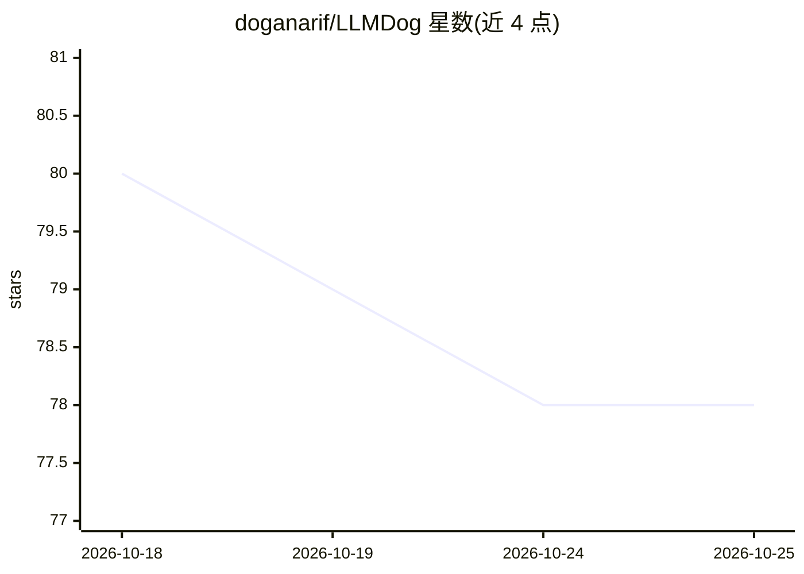

# doganarif/LLMDog

⭐ 78 · Go · MIT · 推送 2026-06-23 · [GitHub](https://github.com/doganarif/LLMDog) · [官网](https://llmdog.arif.sh) · 个人维护

**把项目代码格式化为 Markdown 供 LLM 对话使用的命令行工具**

用 Go 编写的跨平台命令行工具，供开发者把项目代码分享给 Claude、ChatGPT 等大模型：通过交互式 TUI 浏览并选择文件/目录，自动遵循 .gitignore 排除无关路径，生成带目录树、按扩展名语法高亮的 Markdown 输出，并复制到剪贴板以便粘贴进 LLM 聊天界面。本体不调用任何模型 API。安装方式为源码编译（需 Go 1.16+）或 macOS Homebrew tap。

## 筛选速览

| 维度 | 判定 | 备注 |
|---|---|---|
| AI 角色 | `ai-ecosystem` | LLM/agent 周边工具 |
| 许可风险 | `permissive` | MIT |
| 部署形态 | `library` | 以包/库形式分发 |
| 模型依赖 | — | README 未给出锁定关系 |
| 硬件要求 | — | 无带数字的原话,不猜 |
| 安装摩擦 | `low` | 无编译、无系统依赖或容器化 |
| 成熟度 | — | 结构信号不足 |

## 能力要点

- 交互式 TUI 选择文件与目录，支持过滤与预览
- 自动遵循 .gitignore 排除 node_modules 等无关文件
- 生成含目录树的 Markdown 并复制到剪贴板
- Go 编写，支持 macOS/Linux/Windows

## 适用场景

- 向 LLM 提问前只挑选相关文件做代码审查或调试
- 把项目结构与代码整理成 Markdown 粘贴到聊天界面
- 为新功能实现或重构建议提供代码上下文

## 场景标签

 · 领域:开发者工具/LLM 辅助

## 证据(README 行号)

> L4: **LLMDog** is a developer-friendly command-line tool that simplifies sharing your code with Large Language Models (L
> L29: - **Interactive TUI:** Browse and navigate your files and directories with an intuitive interface.

## 星数曲线

2026-10-18 80 → 2026-10-25 78（-2）

---
*卡片 v1 · prompt 1.4 · 生成 2026-10-24 · 置信度 high · 依据 README sha `bce896449051` · [字段定义](../../DATASET.md)*
