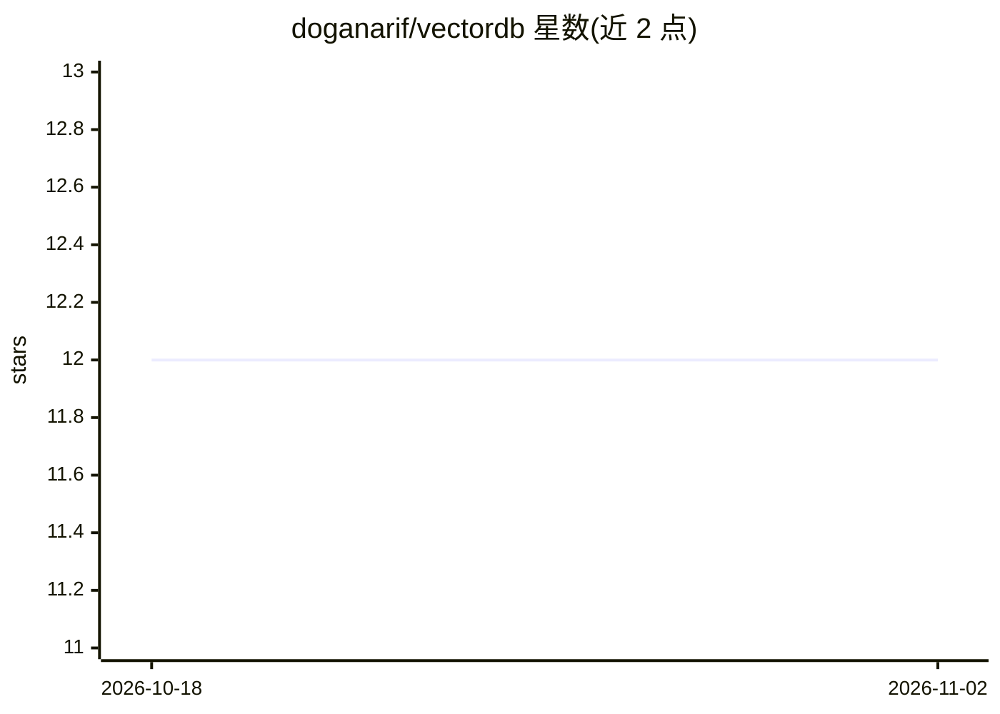

# doganarif/vectordb

⭐ 12 · Python · 推送 2026-06-23 · [GitHub](https://github.com/doganarif/vectordb) · 个人维护

**内存向量数据库：可插拔索引、元数据过滤、FastAPI REST 接口**

纯内存向量数据库服务，提供 Linear/KD-Tree/LSH 三种可插拔索引算法、Cosine 与欧氏距离度量、元数据过滤、快照持久化与恢复、读写锁并发控制，通过 FastAPI 暴露全量 CRUD 与搜索 REST API，并附带 Python SDK。面向需要自托管向量检索后端的开发者。限制：默认仓库按进程存储，多 worker 部署下数据会分裂，需单 worker 或外接持久化存储；/embeddings 端点依赖 Cohere API key，无 key 返回 503。提供 Docker 部署方式与测试套件。

## 筛选速览

| 维度 | 判定 | 备注 |
|---|---|---|
| AI 角色 | `ai-ecosystem` | LLM/agent 周边工具 |
| 许可风险 | `none` | — |
| 部署形态 | `None` |  |
| 模型依赖 | — | README 未给出锁定关系 |
| 硬件要求 | — | 无带数字的原话,不猜 |
| 安装摩擦 | `low` | 无编译、无系统依赖或容器化 |
| 成熟度 | — | 结构信号不足 |

## 能力要点

- 三种索引算法（Linear/KD-Tree/LSH）与两种相似度度量可选组合
- Library→Document→Chunk 三层数据模型与元数据过滤
- 快照持久化/恢复与自定义读写锁并发控制
- FastAPI REST API 全量端点 + Python SDK + Docker 部署

## 适用场景

- 为 RAG 应用自托管一个轻量向量检索后端
- 比较 Linear/KD-Tree/LSH 索引算法在不同数据上的表现
- 通过 REST API 或 Python SDK 管理向量库并执行相似度搜索

## 场景标签

`向量数据库` · 领域:知识与检索

## 证据(README 行号)

> L3: In-memory vector database with pluggable indexing algorithms, metadata filtering, and a FastAPI-based REST API.
> L179: |POST|`/libraries/{id}/chunks/search`|Search vectors|

## 星数曲线

2026-10-18 12 → 2026-11-02 12（+0）

---
*卡片 v1 · prompt 1.4 · 生成 2026-11-01 · 置信度 high · 依据 README sha `0139c1bf8dda` · [字段定义](../../DATASET.md)*
