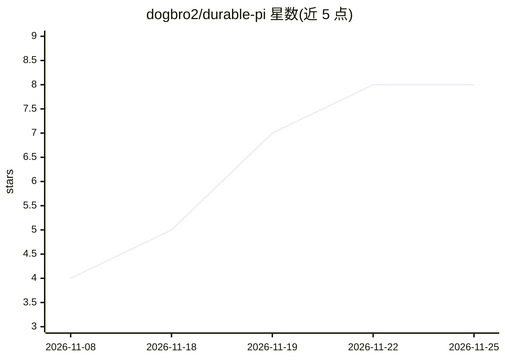

# dogbro2/durable-pi

⭐ 8 · TypeScript · MIT · 推送 2026-10-29 · [GitHub](https://github.com/dogbro2/durable-pi) · 个人维护 · 中文 README

**自架多用户 AI 工作台：持久 agent + 知识库 + 可分享文件**

部署到自己的 Cloudflare 账号的多用户 AI 工作台：单个 Worker 加每用户一个 Durable Object（SQLite 存储），无需外部数据库或 VPS。内置 agent 循环（pi-durable）支持任务持久化、cron 自动化、26 个工具（网页搜索、MCP、子 agent、QuickJS codemode）与工具审批；知识库用 FTS5 中文 bigram 分词与 bm25 检索；文件可一键生成自有域名上的只读分享页。模型通过设置中填入任意 OpenAI 兼容端点接入，无内置 provider。

## 筛选速览

| 维度 | 判定 | 备注 |
|---|---|---|
| AI 角色 | `ai-native` | 本体是模型或模型工具 |
| 许可风险 | `permissive` | MIT |
| 部署形态 | `library` | 以包/库形式分发 |
| 模型依赖 | — | README 未给出锁定关系 |
| 硬件要求 | — | 无带数字的原话,不猜 |
| 安装摩擦 | `low` | 无编译、无系统依赖或容器化 |
| 成熟度 | — | 结构信号不足 |

## 能力要点

- 每用户独立 Durable Object：会话/文件/记忆/知识库/分享令牌隔离
- 技能安装前确定性审计：Python/shell/二进制/未声明网络被阻止
- FTS5 中文 bigram 分词知识库，可选 Workers AI + Vectorize 向量检索
- 文件一键分享到自有域名的只读页面，带过期与撤销

## 适用场景

- 自建一个团队可用的多用户 AI 工作区
- 把 AI 生成的报告以链接形式分享给他人
- 为中文文档搭建可检索的知识库问答

## 场景标签

`文档问答` `AI 助手` · 领域:对话与助手

## 证据(README 行号)

> L5: ### Your own multi-user AI workspace, on Cloudflare's free tier.
> L43: - **A durable agent, not a chat shell.** Work is persisted before it runs. Restart the Durable Object and it contin
> L61: Requirements: Node.js 22, a Cloudflare account (the free plan is enough), and an OpenAI-compatible model endpoint o

## 星数曲线

2026-11-08 4 → 2026-11-25 8（+4）

---
*卡片 v1 · prompt 1.4 · 生成 2026-11-20 · 置信度 high · 依据 README sha `0d98c7929738` · [字段定义](../../DATASET.md)*
