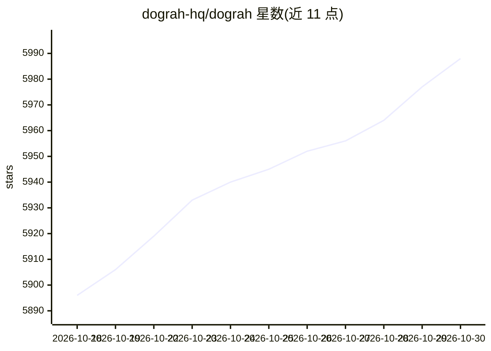

# dograh-hq/dograh

⭐ 5,988 · Python · BSD-2-Clause · 推送 2026-10-28 · [GitHub](https://github.com/dograh-hq/dograh) · [官网](https://app.dograh.com) · 组织维护 · 中文 README

**自托管开源语音 AI 平台：可视化构建电话语音机器人**

面向需要构建生产级语音代理的团队的开源自托管平台（BSD 2-Clause），由 Zansat Technologies 维护。提供可视化工作流编辑器（起始/代理/QA节点、工具调用、知识库、webhook）、内置 LLM/TTS/STT 栈（可换自有 key 与任一提供商）、电话集成（Twilio、Vonage、Telnyx、Plivo、Asterisk ARI 等）与人工转接，支持呼入/呼出场景。内置 MCP server，可供 Claude Code、Codex、Cursor 等编码代理直接创建与编辑工作流。通过一条 Docker 命令自托管，另提供托管云版本与 Python/Node SDK。默认收集匿名遥测数据（可关闭）。

## 筛选速览

| 维度 | 判定 | 备注 |
|---|---|---|
| AI 角色 | `ai-ecosystem` | LLM/agent 周边工具 |
| 许可风险 | `permissive` | BSD-2-Clause |
| 部署形态 | `self-host` | docker 或自建部署 |
| 模型依赖 | — | README 未给出锁定关系 |
| 硬件要求 | — | 无带数字的原话,不猜 |
| 安装摩擦 | `low` | 无编译、无系统依赖或容器化 |
| 成熟度 | — | 结构信号不足 |

## 能力要点

- 可视化工作流构建器与浏览器内 Test Audio/Test Chat 测试
- BYOK：LLM/TTS/STT/电话提供商均可自带，内置默认栈无需 API key
- 内置 MCP server，编码代理可通过自然语言创建和编辑工作流
- 一条 Docker 命令自托管，内置 MinIO 存储，提供 Python/Node SDK

## 适用场景

- 在自有基础设施上构建和运行呼入/呼出电话语音机器人
- 通过可视化工作流或让编码助手经 MCP 代为搭建代理
- 按自有密钥组合 LLM/STT/TTS 供应商部署语音代理

## 场景标签

`语音 Agent` · 领域:对话与助手

## 证据(README 行号)

> L7: **The open-source, self-hostable alternative to Vapi & Retell** — build production voice agents with a visual workfl
> L130: - Visual workflow builder with start nodes, agent nodes, global instructions, tools, transitions, and end-call out
> L115: Dograh ships with an MCP server, so coding agents can work directly inside your Dograh workspace.

## 星数曲线

2026-10-18 5,896 → 2026-10-30 5,988（+92）

---
*卡片 v1 · prompt 1.4 · 生成 2026-10-20 · 置信度 mid · 依据 README sha `79cd831ebbb4` · [字段定义](../../DATASET.md)*
