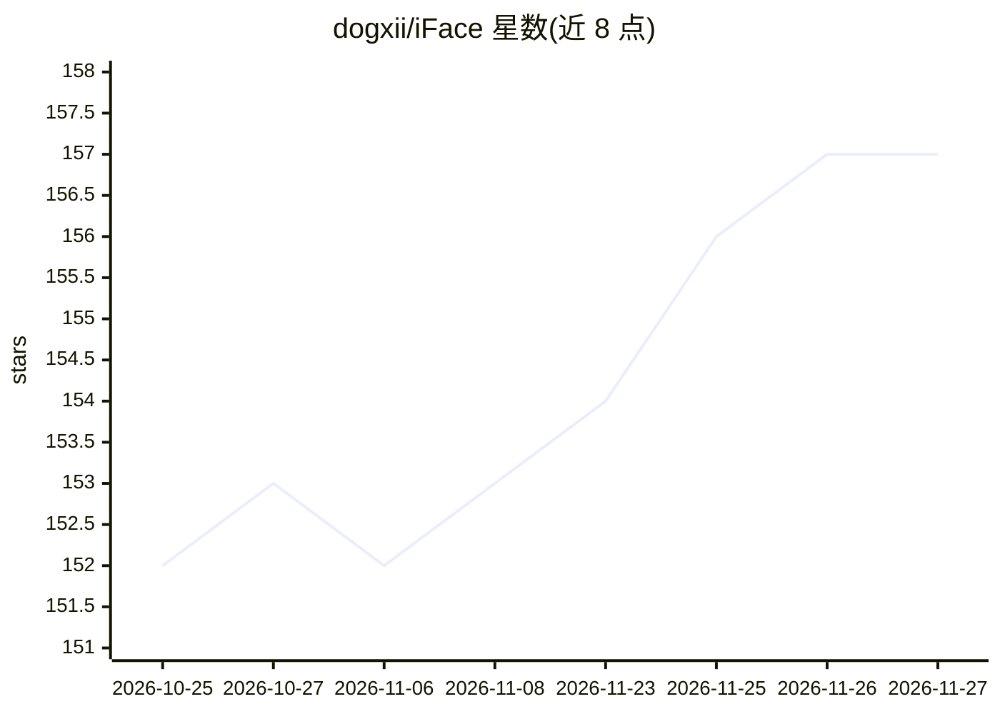

# dogxii/iFace

⭐ 157 · TypeScript · MIT · 推送 2026-11-26 · [GitHub](https://github.com/dogxii/iFace) · [官网](https://face.dogxi.me) · 个人维护 · 中文 README

**工程师面试刷题工具，内置题库与自定义 AI 教练辅助**

面向前端、Golang、Java、AI Agent 等工程师的本地刷题工具：内置题库并支持 JSON/Markdown 导入与粘贴 AI 生成的题目，提供按模块/难度/状态组合练习、间隔复习、薄弱点分析与全局搜索。AI 面试教练功能（拆题、评分作答、追问、模拟面试、简历 JD 诊断）需用户自行填入 API Key 与 Base URL 接入模型。全部数据存于浏览器本地，支持导入导出备份与 GitHub Gist 同步，无需注册与服务器，可安装为 PWA 离线使用。

## 筛选速览

| 维度 | 判定 | 备注 |
|---|---|---|
| AI 角色 | `ai-enhanced` | 去掉 AI 部分产品仍成立 |
| 许可风险 | `permissive` | MIT |
| 部署形态 | `None` |  |
| 模型依赖 | — | README 未给出锁定关系 |
| 硬件要求 | — | 无带数字的原话,不猜 |
| 安装摩擦 | `low` | 无编译、无系统依赖或容器化 |
| 成熟度 | — | 结构信号不足 |

## 能力要点

- 内置前端/Golang/Java/AI Agent 题库，支持 JSON 或 Markdown 导入
- AI 面试教练：拆题、评分作答、追问、模拟面试、简历 JD 诊断
- 自定义 AI 接口：填入 API Key 与 Base URL，选择模型
- 数据全存浏览器本地，支持导入导出备份与 GitHub Gist 同步

## 适用场景

- 备战前端/Golang/Java 面试的模块化刷题与间隔复习
- 用 AI 教练模拟面试并对作答评分、追问
- 导入自定义题库并同步备份学习进度

## 场景标签

`教程课程` · 领域:学习与行业

## 证据(README 行号)

> L29: iFace 是一款专为 前端/Agent/Golang 等工程师备战技术面试打造的本地刷题工具。题库、进度、AI 对话全部存储在浏览器本地，无需注册、无需服务器，打开即用。
> L42: - AI 面试教练：拆题、评分作答、追问，模拟面试，简历 JD 诊断，AI 出题 Prompt
> L96: 3. 填入 API Key 和 Base URL，选择模型，保存

## 星数曲线

2026-10-25 152 → 2026-11-27 157（+5）

---
*卡片 v1 · prompt 1.4 · 生成 2026-11-27 · 置信度 high · 依据 README sha `239a0ca967cd` · [字段定义](../../DATASET.md)*
