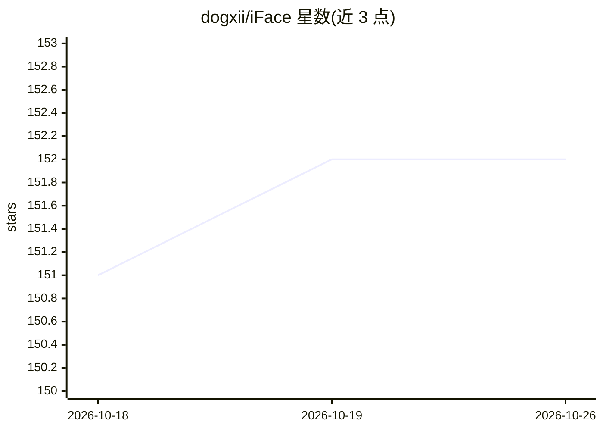

# dogxii/iFace

⭐ 152 · TypeScript · MIT · 推送 2026-09-14 · [GitHub](https://github.com/dogxii/iFace) · [官网](https://face.dogxi.me) · 个人维护 · 中文 README

**本地存储的工程师面试刷题工具，配 AI 面试教练**

面向前端/Agent/Golang 等工程师备战技术面试的本地刷题工具：内置高频题库并支持自定义 JSON 导入，按模块、难度、状态练习，进度数据与 AI 对话均存储在浏览器本地，无需注册和服务器。AI 部分为面试教练功能（拆题、复盘、追问、模拟面试），需用户在设置中自行填入 API Key 与 Base URL 并选择模型，Key 仅存本地。提供线上版本（支持 GitHub 登录备份）与源码本地运行两种方式。README 顶部声明项目正向 UGC 社区版本（QFace）转变，重心转为老功能维护。

## 筛选速览

| 维度 | 判定 | 备注 |
|---|---|---|
| AI 角色 | `ai-enhanced` | 去掉 AI 部分产品仍成立 |
| 许可风险 | `permissive` | MIT |
| 部署形态 | `None` |  |
| 模型依赖 | — | README 未给出锁定关系 |
| 硬件要求 | — | 无带数字的原话,不猜 |
| 安装摩擦 | `low` | 无编译、无系统依赖或容器化 |
| 成熟度 | — | 结构信号不足 |

## 能力要点

- 题库、进度、AI 对话全部本地存储，无需注册与服务器
- AI 面试教练：拆题、复盘、追问与模拟面试
- 自定义题库 JSON 导入，含模块/难度/标签字段
- 线上版支持 GitHub 登录备份数据

## 适用场景

- 备战前端/Golang 等技术面试，按薄弱点刷题
- 让 AI 教练对题目拆解、追问并模拟面试
- 导入自有题库在本地练习并导出备份进度

## 场景标签

 · 领域:教育/面试准备

## 证据(README 行号)

> L27: iFace 是一款专为 前端/Agent/Golang 等工程师备战技术面试打造的本地刷题工具。题库、进度、AI 对话全部存储在浏览器本地，无需注册、无需服务器，打开即用。
> L35: - AI 面试教练：辅助拆题、复盘、追问和模拟面试

## 星数曲线

2026-10-18 151 → 2026-10-26 152（+1）

---
*卡片 v1 · prompt 1.4 · 生成 2026-10-22 · 置信度 high · 依据 README sha `ba5efa5433ba` · [字段定义](../../DATASET.md)*
