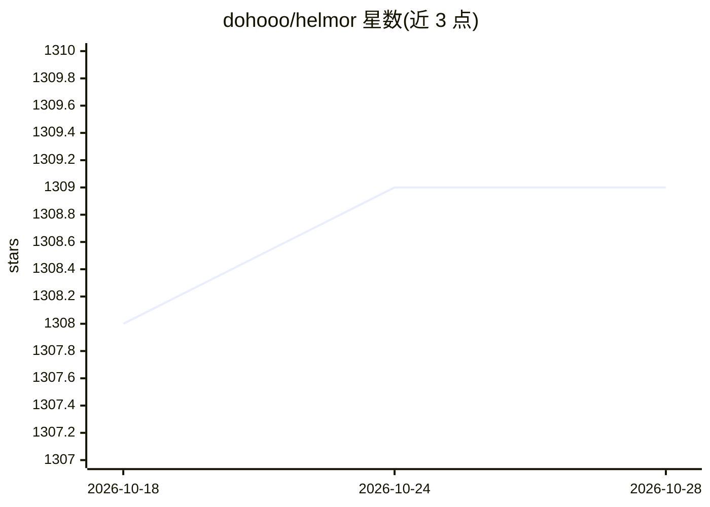

# dohooo/helmor

⭐ 1,308 · TypeScript · Apache-2.0 · 推送 2026-08-22 · [GitHub](https://github.com/dohooo/helmor) · [官网](https://helmor.ai) · 组织维护

**本地优先的编码 agent 编排工作台：并行运行、审查并合并多 agent 产出**

macOS/Windows 桌面应用，将多个编码 agent（Claude Code、Codex、Cursor、OpenCode、Kimi Code）并行运行在各自隔离的 git worktree 与分支中，同一窗口内提供会话、diff、Monaco 编辑器、终端与一键创建/合并 PR（支持 GitHub/GitLab）。数据全部存于本地 ~/helmor/。附带 helmor CLI 与 MCP server 供脚本或其他 agent 驱动；移动端伴侣为实验性。首启需连接 GitHub/GitLab 账号并登录 agent。

## 筛选速览

| 维度 | 判定 | 备注 |
|---|---|---|
| AI 角色 | `ai-ecosystem` | LLM/agent 周边工具 |
| 许可风险 | `permissive` | Apache-2.0 |
| 部署形态 | `None` |  |
| 模型依赖 | — | README 未给出锁定关系 |
| 硬件要求 | — | 无带数字的原话,不猜 |
| 安装摩擦 | `low` | 无编译、无系统依赖或容器化 |
| 成熟度 | `idea` | |

## 能力要点

- 每任务一个 git worktree 与分支，agent 之间互不干扰
- 支持接入 Claude Code、Codex、Cursor、OpenCode、Kimi Code 及自定义 provider
- 同一窗口内 diff 审查、编辑器、终端与 PR/MR 创建、合并、冲突解决、堆叠 PR
- helmor CLI 与 MCP server 支持脚本化及 agent 驱动，命令支持 --json 输出

## 适用场景

- 并行派发多个编码 agent 处理不同任务并隔离工作区
- 在本地统一审查 agent 的 diff、运行测试并完成合并
- 通过 CLI 或 MCP 让其他 agent 驱动 Helmor 完成修复流程

## 场景标签

`多智能体` `编码 Agent` · 领域:Agent 开发

## 证据(README 行号)

> L19: Helmor runs many coding agents in parallel, each in its own isolated git
> L26: - **Bring your own agents** — Claude Code, Codex, Cursor, OpenCode, and Kimi Code; your logins, API keys, and custo
> L31: - **Scriptable** — `helmor` CLI and MCP server; your terminal or another agent can drive Helmor.

## 星数曲线

2026-10-18 1,308 → 2026-10-28 1,309（+1）

---
*卡片 v1 · prompt 1.4 · 生成 2026-10-21 · 置信度 high · 依据 README sha `c21d6a8bf802` · [字段定义](../../DATASET.md)*
