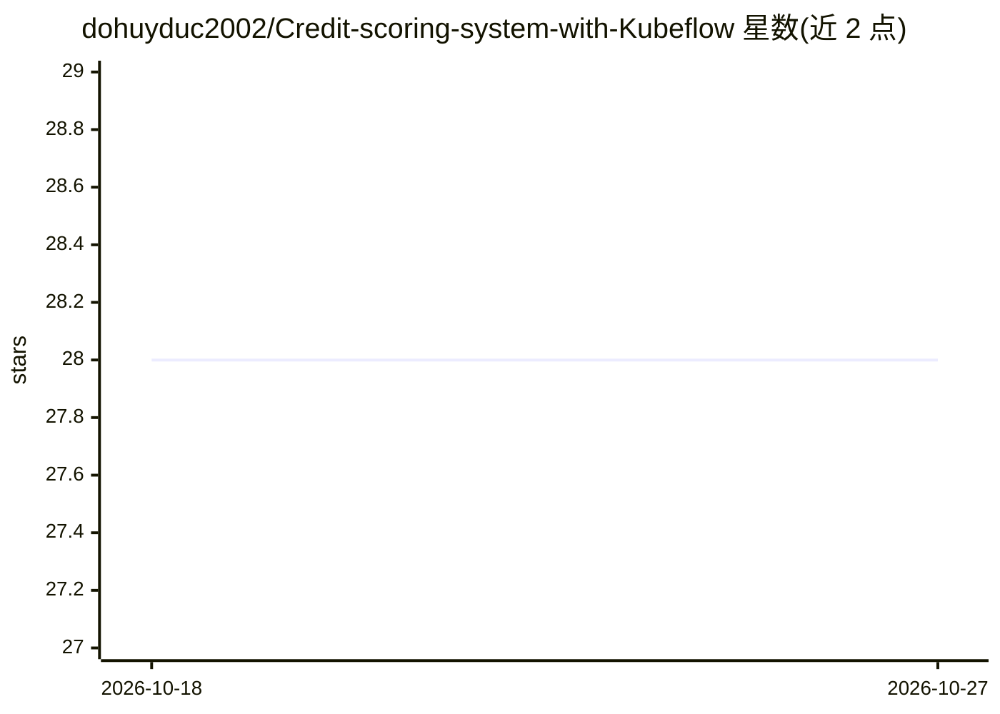

# dohuyduc2002/Credit-scoring-system-with-Kubeflow

⭐ 28 · Python · NOASSERTION · 推送 2026-03-05 · [GitHub](https://github.com/dohuyduc2002/Credit-scoring-system-with-Kubeflow) · 个人维护

**基于 Kubeflow 的信贷评分端到端 MLOps 平台（GCP/Azure）**

面向数据科学团队的端到端 MLOps 平台：在 GCP GKE 上以 Terraform 为 IaC 部署定制化 Kubeflow 平台，训练流程使用 Kubeflow Pipelines 与 Notebook，模型经 MLflow 注册后由 FastAPI 端点提供服务（Streamlit UI），并用 Prometheus、Grafana、Evidently 监控系统指标与模型性能。业务场景为 Kaggle Home Credit Default Risk 数据集上的贷款审批预测。数据摄取、Kafka/Flink/Spark 管道、特征存储等仍在 To-Do 中，README 声明为 v1.2 版本。

## 筛选速览

| 维度 | 判定 | 备注 |
|---|---|---|
| AI 角色 | `ai-ecosystem` | LLM/agent 周边工具 |
| 许可风险 | `none` | NOASSERTION |
| 部署形态 | `self-host` | docker 或自建部署 |
| 模型依赖 | — | README 未给出锁定关系 |
| 硬件要求 | — | 无带数字的原话,不猜 |
| 安装摩擦 | `low` | 无编译、无系统依赖或容器化 |
| 成熟度 | `idea` | |

## 能力要点

- Terraform 管理 GKE 基础设施，Kustomize 部署 Kubeflow
- MLflow 注册模型，FastAPI + Streamlit 提供推理端点
- Prometheus/Grafana/Evidently 监控系统与模型性能指标
- Nginx ingress 暴露各服务并通过 Minio 管理数据与制品

## 适用场景

- 搭建跨云的 ML 训练、部署与监控流水线
- 信贷审批场景下实践 Kubeflow 全流程 MLOps
- 参考 Kubeflow/MLflow/Minio 的 Kubernetes 部署配置

## 场景标签

`MLOps` · 领域:训练与推理

## 证据(README 行号)

> L2: An platform for Data Science team to build and serve ML model using multi cloud environment (GCP and Azure) with CI/
> L43: To automate the training and logging process, I'm using Kubeflow Pipelines and Kubeflow Notebook under Kubeflow pla
> L124: Kubeflow is an open-source platform designed to facilitate the deployment, orchestration, and management of machin

## 星数曲线

2026-10-18 28 → 2026-10-27 28（+0）

---
*卡片 v1 · prompt 1.4 · 生成 2026-10-26 · 置信度 high · 依据 README sha `3db915decc6c` · [字段定义](../../DATASET.md)*
