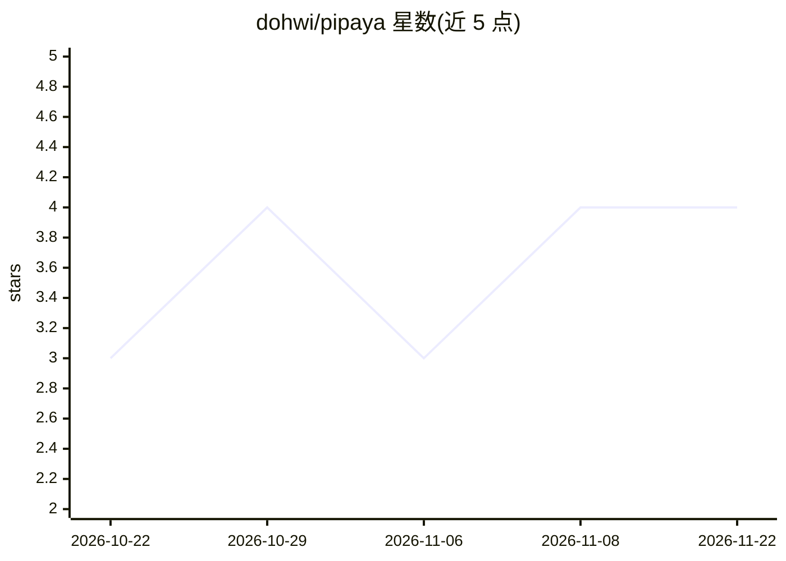

# dohwi/pipaya

⭐ 4 · TypeScript · MIT · 推送 2026-11-21 · [GitHub](https://github.com/dohwi/pipaya) · [官网](https://pipaya.dohwi.com) · 个人维护

**自托管在自有服务器上的 AI agent 聊天工具**

运行在用户自有服务器上的 AI agent 聊天工具，会话、设置与 API key 存储在服务端 SQLite 数据库中，无需云账号。Agent 内置 read/write/edit/ls/grep/bash 工具并可通过扩展增加；支持内置 provider、本地推理服务器（Ollama、LM Studio、llama.cpp、vLLM）或自定义端点。提供 Windows/macOS/Android/web 多端客户端，单屏最多 8 会话分屏，支持 AGENTS.md、skills、templates、subagents 等扩展机制。README 警告 token 具管理员权限、API key 未加密存储、bash 无沙箱。

## 筛选速览

| 维度 | 判定 | 备注 |
|---|---|---|
| AI 角色 | `ai-native` | 本体是模型或模型工具 |
| 许可风险 | `permissive` | MIT |
| 部署形态 | `None` |  |
| 模型依赖 | local-ok | 支持本地模型 |
| 硬件要求 | — | 无带数字的原话,不猜 |
| 安装摩擦 | `low` | 无编译、无系统依赖或容器化 |
| 成熟度 | — | 结构信号不足 |

## 能力要点

- Agent 内置 read/write/edit/ls/grep/bash 工具，可通过扩展增加更多
- 支持本地推理服务器（Ollama、LM Studio、llama.cpp、vLLM）或自定义端点
- Windows/macOS/Android/web 多端共享同一会话，单屏最多 8 路分屏
- 数据（会话、设置、API key）存于自有服务器的 SQLite

## 适用场景

- 在自有服务器上运行 coding agent，不依赖云账号
- 手机与桌面等多设备共享同一个 agent 会话
- 接入本地模型服务器运行 agent

## 场景标签

`编码 Agent` · 领域:编码与开发

## 证据(README 行号)

> L5:  An AI agent chat tool that runs on your own server. Sessions, settings and API keys stay in your server's SQLite da
> L20: - **Agent with built-in tools**: read, write, edit, ls, grep, bash. More via extensions
> L21: - **Any model**: built-in providers, local servers (Ollama, LM Studio, llama.cpp, vLLM) or your own endpoint

## 星数曲线

2026-10-22 3 → 2026-11-22 4（+1）

---
*卡片 v1 · prompt 1.4 · 生成 2026-11-21 · 置信度 high · 依据 README sha `908e57ab3d67` · [字段定义](../../DATASET.md)*
