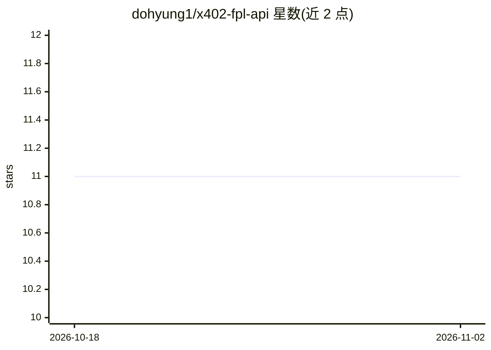

# dohyung1/x402-fpl-api

⭐ 11 · Python · MIT · 推送 2026-03-23 · [GitHub](https://github.com/dohyung1/x402-fpl-api) · 个人维护

**让 Claude 分析英超幻想足球（FPL）的 MCP 服务器**

面向 Claude Desktop 用户的 MCP server，通过官方 FPL API 实时数据提供 12 个工具：队长推荐、转会建议、球员对比、扣分计算、芯片策略、差异化选人、赛程难度、价格预测、实时积分、对手侦察与联赛胜率分析等。服务器本地运行，除 FPL API 调用外无数据外传，无需 API key；队伍余额、免转会次数与芯片状态从队伍 ID 自动读取。通过 pip 安装并执行 --setup 命令接入 Claude Desktop，也可从源码用 uv 运行。限制：需 Python 3.12+，FPL API 截止日前和赛季间歇期可能不可用。

## 筛选速览

| 维度 | 判定 | 备注 |
|---|---|---|
| AI 角色 | `ai-ecosystem` | LLM/agent 周边工具 |
| 许可风险 | `permissive` | MIT |
| 部署形态 | `library` | 以包/库形式分发 |
| 模型依赖 | locked-api |  |
| 硬件要求 | — | 无带数字的原话,不猜 |
| 安装摩擦 | `low` | 无编译、无系统依赖或容器化 |
| 成熟度 | — | 结构信号不足 |

## 能力要点

- 12 个 FPL 分析工具（队长/转会/芯片/对手侦察等）
- 读取官方 FPL API 实时数据，无需 API key 与账号
- 本地运行，仅 FPL API 调用外传数据
- pip 安装后 fpl-intelligence --setup 一键接入 Claude Desktop

## 适用场景

- 让 Claude 分析我的 FPL 队伍并给出队长与转会建议
- 查看小联赛对手阵容弱点与联赛胜率
- 决定何时使用芯片、是否值得吃 -4 分

## 场景标签

`数据分析` · 领域:效率与自动化

## 证据(README 行号)

> L10: Turn Claude into your FPL analyst. Captain picks, transfer advice, rival scouting, chip timing, league predictions 
> L85: The server runs locally on your machine and talks to Claude Desktop via MCP. No API keys, no accounts, no data leav

## 星数曲线

2026-10-18 11 → 2026-11-02 11（+0）

---
*卡片 v1 · prompt 1.4 · 生成 2026-11-02 · 置信度 high · 依据 README sha `46c36988435b` · [字段定义](../../DATASET.md)*
