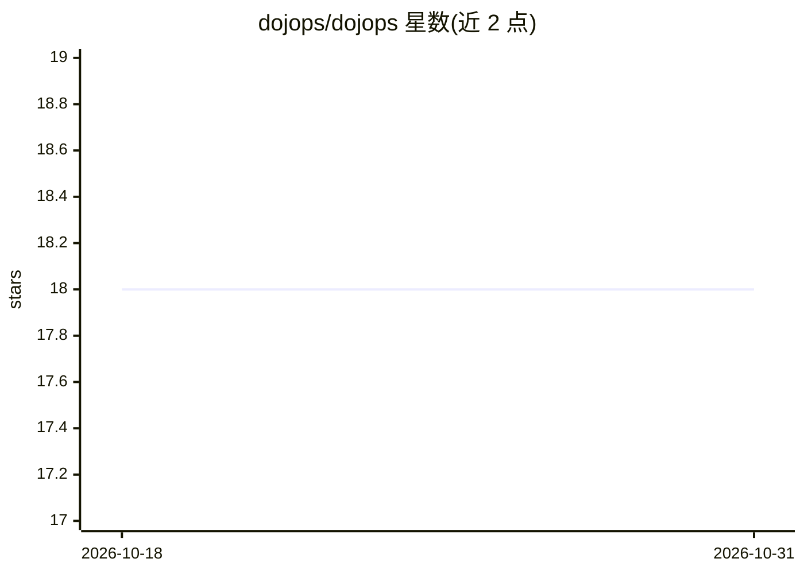

# dojops/dojops

⭐ 18 · TypeScript · MIT · 推送 2026-06-30 · [GitHub](https://github.com/dojops/dojops) · [官网](https://dojops.ai) · 组织维护

**面向 DevOps 的 AI 自动化引擎：生成并校验 IaC/CI/安全配置**

介于用户与 LLM 提供商之间的自动化引擎：将自然语言需求路由到 32 个专家 Agent 与 38 个内置技能，生成 Terraform、Kubernetes、CI/CD、Helm 等配置，经 Zod schema 约束与外部工具（terraform validate、hadolint 等）校验后，通过带审批门与备份的沙箱写入文件，并写入哈希链审计日志。支持 7 家 LLM 提供商分层路由、10 种安全扫描器、任务 DAG 规划与自主修复循环，另提供 CLI、REST API 与 Web 仪表盘。

## 筛选速览

| 维度 | 判定 | 备注 |
|---|---|---|
| AI 角色 | `ai-ecosystem` | LLM/agent 周边工具 |
| 许可风险 | `permissive` | MIT |
| 部署形态 | `self-host` | docker 或自建部署 |
| 模型依赖 | local-ok | 支持本地模型 |
| 硬件要求 | — | 无带数字的原话,不猜 |
| 安装摩擦 | `low` | 无编译、无系统依赖或容器化 |
| 成熟度 | — | 结构信号不足 |

## 能力要点

- 32 个专家 Agent 按提示自动路由，支持自定义 YAML Agent
- 38 个 .dops v2 技能清单覆盖 GitHub Actions/Terraform/K8s/Helm 等工具配置生成
- 7 家 LLM 提供商（含本地 Ollama）分层模型路由
- 沙箱写入、策略引擎与 SHA-256 哈希链审计日志

## 适用场景

- 用自然语言生成并校验 Terraform/K8s/CI 配置
- 运行 dojops scan 并按建议自动修复安全问题
- 将复杂目标分解为任务 DAG 并按序执行、失败自修复
- 通过 REST API 与仪表盘在团队内提供配置生成服务

## 场景标签

`代码生成` `网络安全` `工作流自动化` · 领域:效率与自动化

## 证据(README 行号)

> L29: DojOps sits between you and your LLM provider. It constrains output to Zod schemas, validates configs with external
> L32: You → DojOps CLI → Agent Router → Specialist Agent → LLM Provider
> L145:  7 LLM providers - tiered model routing across all of them

## 星数曲线

2026-10-18 18 → 2026-10-31 18（+0）

---
*卡片 v1 · prompt 1.4 · 生成 2026-10-29 · 置信度 mid · 依据 README sha `c25ddde6bc0c` · [字段定义](../../DATASET.md)*
