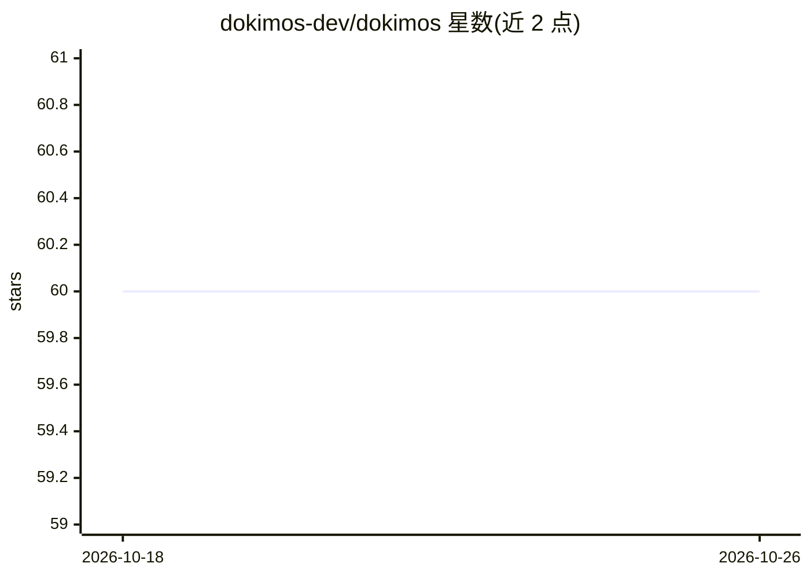

# dokimos-dev/dokimos

⭐ 60 · Java · MIT · 推送 2026-10-22 · [GitHub](https://github.com/dokimos-dev/dokimos) · [官网](https://dokimos.dev) · 组织维护

**面向 Java/Kotlin 的 LLM 与 agent 评测框架，可跑在 JUnit 与 CI 中**

以 Maven 依赖形式提供的 LLM 应用评测框架：内置幻觉检测、忠实度、上下文相关性、LLM as a judge 等评测器，支持从 JSON/CSV 加载测试集并以 @DatasetSource 作为参数化 JUnit 测试运行；还评估 agent 的工具调用正确性、任务完成度与参数幻觉。集成 LangChain4j、Spring AI、Spring AI Alibaba、Koog、Embabel，并提供可选的实验服务器（API+Web UI）与 MCP server 模块。要求 Java 17+（Embabel 集成需 Java 21+）。

## 筛选速览

| 维度 | 判定 | 备注 |
|---|---|---|
| AI 角色 | `ai-ecosystem` | LLM/agent 周边工具 |
| 许可风险 | `permissive` | MIT |
| 部署形态 | `self-host` | docker 或自建部署 |
| 模型依赖 | — | README 未给出锁定关系 |
| 硬件要求 | — | 无带数字的原话,不猜 |
| 安装摩擦 | `low` | 无编译、无系统依赖或容器化 |
| 成熟度 | — | 结构信号不足 |

## 能力要点

- JUnit/CI 集成，评测失败可阻断构建
- 内置幻觉检测、忠实度、LLM as a judge 等评测器
- agent 评测：工具调用校验、任务完成度、参数幻觉检测
- 五种框架适配器并跟踪每次调用的 token 成本与延迟
- 可选实验服务器提供 Web UI 追踪结果

## 适用场景

- 在现有 Java/Kotlin 测试套件中评测 LLM 回答质量
- 在 CI/CD 中拦截 LLM 应用质量回归
- 评测 agent 的工具调用与任务完成情况
- 跨运行聚合实验结果并导出报告

## 场景标签

`模型评测` · 领域:评测与运维

## 证据(README 行号)

> L17: Dokimos is an evaluation framework for LLM applications in Java and Kotlin. It helps you evaluate responses, track 
> L19: It integrates with **JUnit**, **LangChain4j**, **Spring AI**, **Spring AI Alibaba**, **Koog**, and **Embabel** so y
> L30: - **CI/CD ready**: Runs locally or in any CI/CD environment. Fail builds when quality drops.

## 星数曲线

2026-10-18 60 → 2026-10-26 60（+0）

---
*卡片 v1 · prompt 1.4 · 生成 2026-10-24 · 置信度 high · 依据 README sha `26c4add57d0a` · [字段定义](../../DATASET.md)*
