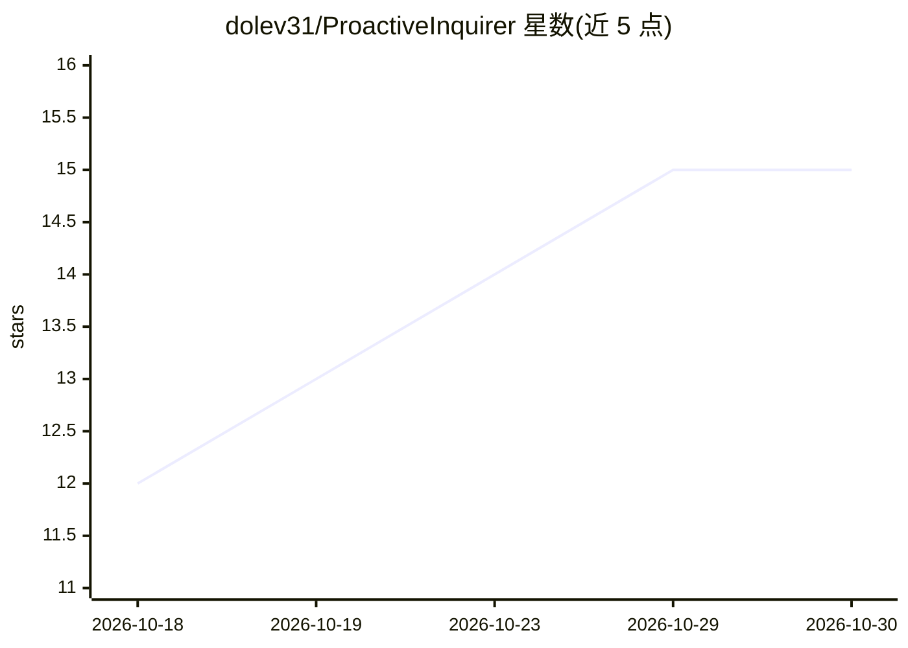

# dolev31/ProactiveInquirer

⭐ 15 · Python · Apache-2.0 · 推送 2026-10-04 · [GitHub](https://github.com/dolev31/ProactiveInquirer) · [官网](https://dolev31.github.io/ProactiveInquirer/) · 组织维护

**研究代码库：用需求图评测 agent 主动性并以 Q&D 训练提问器**

IBM 与魏茨曼科学研究所研究团队的论文配套代码：研究工具型 agent 应主动追问什么信息，提出水平/垂直两类主动性，用从基准自身分解中恢复的需求图做无裁判评分（含同提问数对齐、停止时机判定）；Q&D 通过分叉运行、比较候选问题后续检索到的证据量来训练提问器（模仿+DPO），产物为 Qwen3-8B 上的 LoRA 适配器（🤗 公开，附 GGUF）。核心库 pinq 仅依赖标准库，通过 Retriever/Drafter/Answerer 协议接入自有 agent；模型调用走 LiteLLM。含数据构建、复现、训练阶梯文档与 5000+ 测试。

## 筛选速览

| 维度 | 判定 | 备注 |
|---|---|---|
| AI 角色 | `ai-ecosystem` | LLM/agent 周边工具 |
| 许可风险 | `permissive` | Apache-2.0 |
| 部署形态 | `library` | 以包/库形式分发 |
| 模型依赖 | local-ok | 支持本地模型 |
| 硬件要求 | — | 无带数字的原话,不猜 |
| 安装摩擦 | `low` | 无编译、无系统依赖或容器化 |
| 成熟度 | — | 结构信号不足 |

## 能力要点

- 需求图指标：无 LLM 裁判，从 transcript 直接评分两类主动性与停止时机
- Q&D 训练：从问题的后果构造偏好对（模仿 SFT + DPO），无需奖励模型
- 已发布训练好的 Qwen3-8B LoRA 提问器，含 GGUF（Ollama/LM Studio/llama.cpp）
- pinq 核心库仅依赖标准库，实现三个协议即可接入自有 agent

## 适用场景

- 我需要评测 agent 主动提问的质量而非数量
- 我想在自己的客服 agent 上接入训练好的提问器
- 我想复现论文实验或重新训练提问器

## 场景标签

`模型评测` `微调` `科研工具` · 领域:评测与运维

## 证据(README 行号)

> L24: > never mentions. We study *what* an agent pursues unasked, measure it against need graphs with no
> L25: > model judge, and train it with **Q&D** from the consequences of its own questions. The trained 8B
> L48: - **Trained from consequences.** Q&D (questioner and drafter) forks a run, continues it after several

## 星数曲线

2026-10-18 12 → 2026-10-30 15（+3）

---
*卡片 v1 · prompt 1.4 · 生成 2026-10-30 · 置信度 mid · 依据 README sha `e9007ffaef6f` · [字段定义](../../DATASET.md)*
