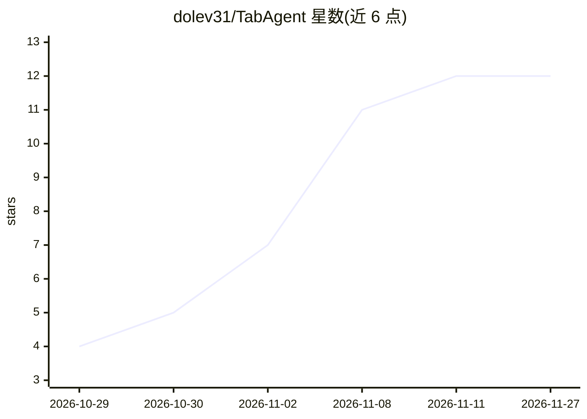

# dolev31/TabAgent

⭐ 12 · Python · Apache-2.0 · 推送 2026-10-29 · [GitHub](https://github.com/dolev31/TabAgent) · [官网](https://dolev31.github.io/TabAgent/) · 组织维护

**将 LLM Agent 的封闭集决策蒸馏为廉价分类器的工具库**

面向 LLM Agent 的决策替换库：从 Agent 自身的成功运行日志中，通过 TabSchema 发现特征、TabSynth 做标签保持的改写扩充、TabHead 训练 CatBoost 分类头，在推理时一次打分选出工具/技能/子 Agent/模型路由等候选，不确定时回退给 LLM。提供 CLI（scan/onboard/serve）、HTTP 决策服务、OpenAI ToolFilter 集成与 scikit-learn 估计器接口，预训练头发布在 Hugging Face，论文结果可按命令复现。

## 筛选速览

| 维度 | 判定 | 备注 |
|---|---|---|
| AI 角色 | `ai-ecosystem` | LLM/agent 周边工具 |
| 许可风险 | `permissive` | Apache-2.0 |
| 部署形态 | `library` | 以包/库形式分发 |
| 模型依赖 | — | README 未给出锁定关系 |
| 硬件要求 | — | 无带数字的原话,不猜 |
| 安装摩擦 | `low` | 无编译、无系统依赖或容器化 |
| 成熟度 | `idea` | |

## 能力要点

- 三阶段流程：TabSchema 特征发现、TabSynth 数据扩充、TabHead CatBoost 一次打分
- 置信度门控可将不确定决策回退给 LLM，支持热替换原 LLM 调用
- 提供 tabagent serve HTTP 服务，带 Prometheus 指标与漂移监控
- 公开基准结果提供逐条复现命令，预训练头可从 Hugging Face 加载

## 适用场景

- 从自己的 Agent 日志中提炼可替换的封闭集决策
- 在工具调用 LLM 前加 ToolFilter 只保留短名单工具
- 在 CPU 环境复现论文中表格与图形的结果

## 场景标签

 · 领域:LLM 基础设施/Agent 决策优化

## 证据(README 行号)

> L20: The TabAgent explainer, condensed: an agent asks a frontier LLM again and again; its successful runs become a table
> L54: |Phase 3: TabHead|**Decides in milliseconds.** A CatBoost classifier scores every candidate in one pass; a confiden
> L159: **1. Onboard** a decision from the agent's own logs (OpenAI, Anthropic, LangChain, τ²-bench, CUGA or generic JSON)

## 星数曲线

2026-10-29 4 → 2026-11-27 12（+8）

---
*卡片 v1 · prompt 1.4 · 生成 2026-11-18 · 置信度 high · 依据 README sha `356c7d5fc6d0` · [字段定义](../../DATASET.md)*
