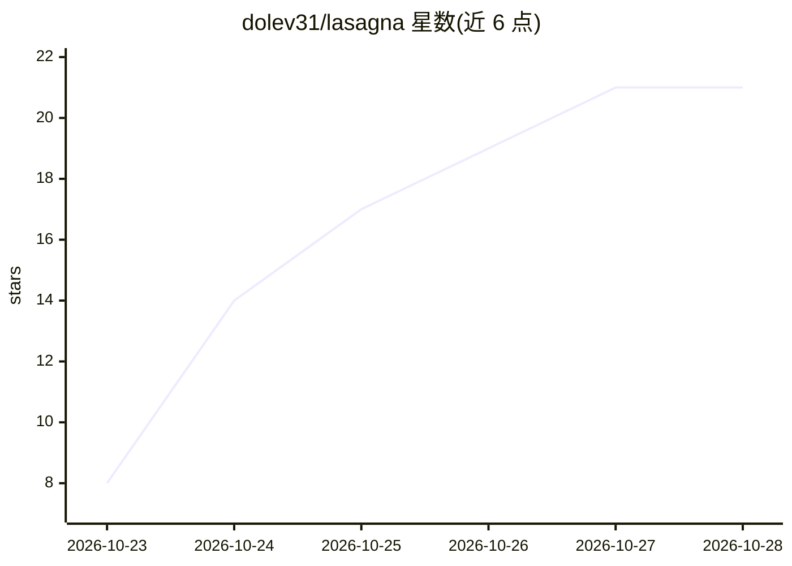

# dolev31/lasagna

⭐ 23 · Python · Apache-2.0 · 推送 2026-10-28 · [GitHub](https://github.com/dolev31/lasagna) · [官网](https://dolev31.github.io/lasagna/) · 组织维护

**RAG 组件对照评测框架：只换一个阶段、固定其余并测显著性**

论文 "Retrieval Augmented Generation Compositionality" 的代码，由 IBM 与魏茨曼科学研究所作者维护。将 RAG 拆为八个可替换阶段（document_processor 到 generator），用户以单装饰器函数或 from_langchain/from_llamaindex 包装器接入自己的组件，其余阶段保持固定，通过配对符号翻转检验、Holm 校正与 2x2 交互检验度量组件增益。内置 BEIR/MTEB 基准加载器与复现实验，另提供 CLI、REST API 与 MCP server 供 agent 检索自有文档。限制：无预建索引，torch 与 sentence-transformers 为核心依赖（安装约 1.3–3.2 GB），默认 profile 首次下载约 3.2 GB。

## 筛选速览

| 维度 | 判定 | 备注 |
|---|---|---|
| AI 角色 | `ai-ecosystem` | LLM/agent 周边工具 |
| 许可风险 | `permissive` | Apache-2.0 |
| 部署形态 | `self-host` | docker 或自建部署 |
| 模型依赖 | — | README 未给出锁定关系 |
| 硬件要求 | — | 无带数字的原话,不猜 |
| 安装摩擦 | `low` | 无编译、无系统依赖或容器化 |
| 成熟度 | `idea` | |

## 能力要点

- 八阶段交换式 RAG 管线，一次只换一个组件并保持其余固定
- 配对符号翻转检验、Holm-Bonferroni 校正、2x2 组件交互检验
- 内置 BEIR/MTEB 基准加载器，SciFact/NFCorpus 结果与已发表数字差距 ≤0.004 NDCG@10
- 同一检索管线可经 MCP server、REST API 与 Docker 交给 agent 使用

## 适用场景

- 我改了 reranker/chunker/embedder，想知道在完整 RAG 栈里增益是否成立
- 写论文或审稿时需要可辩护的显著性检验与结果溯源
- 让 agent 通过 MCP/REST 检索我自己的文档，且配置与评测一致

## 场景标签

`RAG` `模型评测` · 领域:评测与运维

## 证据(README 行号)

> L3: **Test your RAG components against a real stack, not a toy baseline. Then give that stack to your agent.**
> L66: Lasagna is not an alternative to LangChain, LlamaIndex or RAGAS: LangChain and
> L76: What it adds is the measurement apparatus: a paired sign-flip test with t

## 星数曲线

2026-10-23 8 → 2026-10-28 21（+13）

---
*卡片 v1 · prompt 1.4 · 生成 2026-10-28 · 置信度 mid · 依据 README sha `e0c19cb9d3e4` · [字段定义](../../DATASET.md)*
