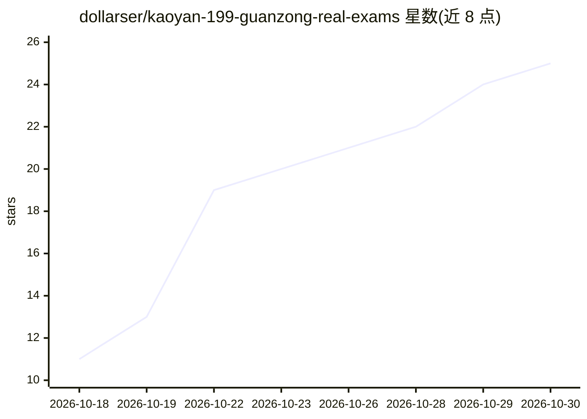

# dollarser/kaoyan-199-guanzong-real-exams

⭐ 25 · Python · 推送 2026-09-15 · [GitHub](https://github.com/dollarser/kaoyan-199-guanzong-real-exams) · 个人维护 · 中文 README

**考研管综 199 历年真题结构化题库，附 RAG 切分库**

收录 2009–2026 年管理类联考综合能力（199）真题的仓库：每年一卷 57 题，以人工/多模态校核的 Markdown 为唯一内容源，另含答案解析 md（RapidOCR 提取并经 VLM 逐页校核）、原卷 PDF 与逐题切片图。提供四个 Python 脚本按需重建真题/答案的 RAG 切分库（JSONL，按 year/question_no 关联，18 年 1026 条）与切片图，带参数校验、原子写、拒绝覆盖已校核文件等护栏。附备考指南与技术总结文档。依赖 PyMuPDF、rapidocr_onnxruntime、Pillow。

## 筛选速览

| 维度 | 判定 | 备注 |
|---|---|---|
| AI 角色 | `ai-knowledge` | 知识聚合/清单类 |
| 许可风险 | `none` | — |
| 部署形态 | `library` | 以包/库形式分发 |
| 模型依赖 | — | README 未给出锁定关系 |
| 硬件要求 | — | 无带数字的原话,不猜 |
| 安装摩擦 | `low` | 无编译、无系统依赖或容器化 |
| 成熟度 | — | 结构信号不足 |

## 能力要点

- 2009–2026 共 18 卷 × 57 题的结构化 Markdown 题库，逐题人工/多模态校核
- 真题与答案解析双 JSONL RAG 切分库，按 (year, question_no) 关联
- 四个重建脚本带护栏：年份参数校验、原子写、拒绝覆盖已校核 md
- 2026 年解析为人工整理并经程序穷举复核

## 适用场景

- 搭建考研管综问答/刷题系统的 RAG 知识库
- 按年份、题型（数学/逻辑/写作）检索历年真题与解析
- 做管综 18 年考点的量化统计分析

## 场景标签

`RAG` · 领域:知识与检索

## 证据(README 行号)

> L3: 199 管综历年真题(试卷 + 答案解析)的结构化 Markdown 题库 + RAG 切分库(JSONL),
> L60:  字段:year / question_no / category / answer / part / parts / part_label /

## 星数曲线

2026-10-18 11 → 2026-10-30 25（+14）

---
*卡片 v1 · prompt 1.4 · 生成 2026-10-28 · 置信度 mid · 依据 README sha `3c091da43e29` · [字段定义](../../DATASET.md)*
