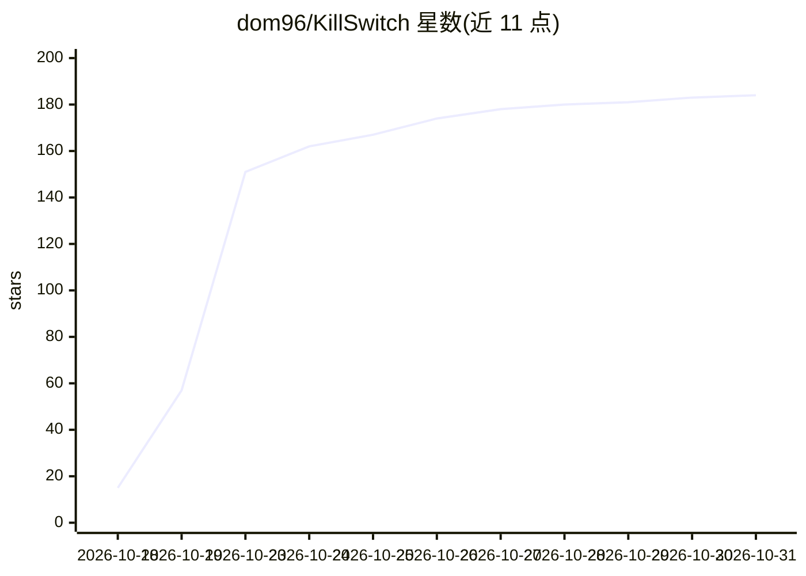

# dom96/KillSwitch

⭐ 184 · Rust · AGPL-3.0 · 推送 2026-09-20 · [GitHub](https://github.com/dom96/KillSwitch) · [官网](https://killswitch-lang.org) · 个人维护

**专为让 LLM 无法生成/修改代码而设计的深奥编程语言**

KillSwitch 是一门深奥编程语言（esolang），设计目标是使 LLM 难以生成和修改其代码。仓库包含语言规范 SPEC.md、Rust 参考实现、官方网站 killswitch-lang.org 以及针对 LLM 的编程任务基准测试。提供 cargo install 安装、killswitch run 运行源文件、anagram 工具与测试命令。作者声明仓库原始代码为人工编写，并计划继续在不借助 LLM 的情况下维护。许可证为 AGPLv3。

## 筛选速览

| 维度 | 判定 | 备注 |
|---|---|---|
| AI 角色 | `ai-ecosystem` | LLM/agent 周边工具 |
| 许可风险 | `viral` | AGPL-3.0 |
| 部署形态 | `library` | 以包/库形式分发 |
| 模型依赖 | — | README 未给出锁定关系 |
| 硬件要求 | — | 无带数字的原话,不猜 |
| 安装摩擦 | `low` | 无编译、无系统依赖或容器化 |
| 成熟度 | — | 结构信号不足 |

## 能力要点

- 设计目标为 LLM 无法生成/修改的语言
- 包含 SPEC.md 规范与 Rust 参考实现
- 提供 LLM 编程任务基准测试（Benchmarks）
- 附带 anagram 标识符变位词校验工具

## 适用场景

- 测试 LLM 与编程 agent 在对抗性语言上的能力边界
- 作为 LLM 编程基准测试的任务语言
- 研究深奥语言设计中对抗机器生成代码的机制

## 场景标签

`模型评测` · 领域:评测与运维

## 证据(README 行号)

> L1: ## KillSwitch - Esoteric programming language that is deadly for LLMs
> L3: This repo contains the design and reference implementation of the KillSwitch programming language. KillSwitch is an 
> L7: - Benchmarks - LLM model benchmarks for KillSwitch programming tasks.

## 星数曲线

2026-10-18 15 → 2026-10-31 184（+169）

---
*卡片 v1 · prompt 1.4 · 生成 2026-10-23 · 置信度 high · 依据 README sha `80d6cffd5483` · [字段定义](../../DATASET.md)*
