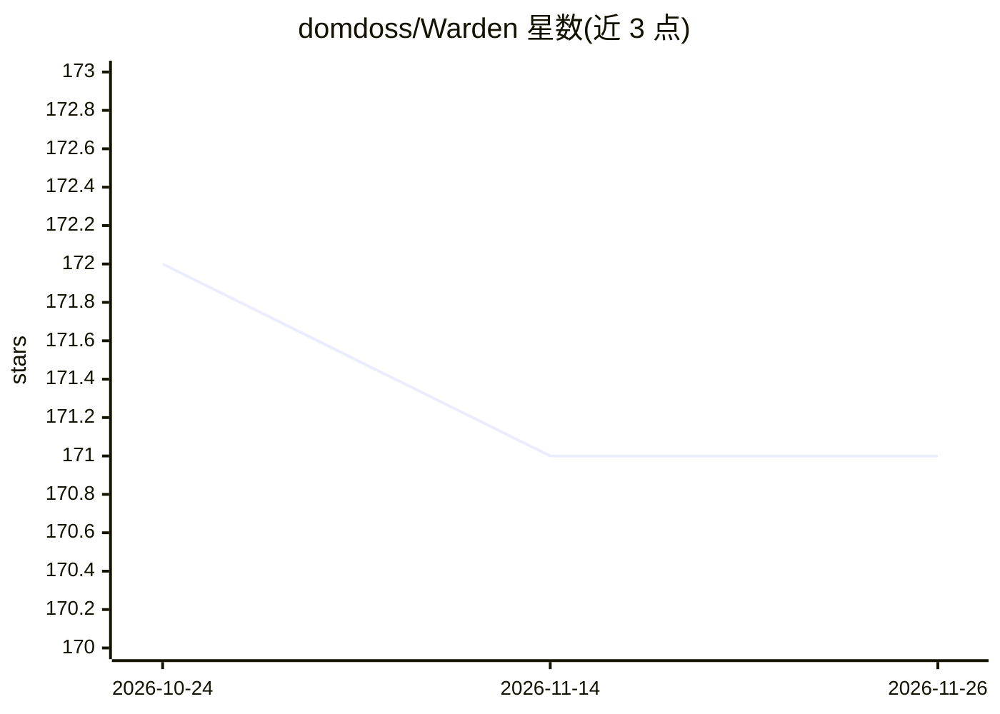

# domdoss/Warden

⭐ 171 · JavaScript · NOASSERTION · 推送 2026-11-14 · [GitHub](https://github.com/domdoss/Warden) · [官网](https://aionsystems.ca) · 个人维护

**桌面个人 AI 助理：本地 Ollama 与云模型混合驱动、可操作电脑的 Agent**

Warden 是驻留桌面的个人 AI 助理，通过 Ollama 运行本地模型处理快速私有任务，重活交由云模型，单对话内混合调度。单一主 seat 模型既回答又亲自执行（浏览器、桌面、shell、文件），将邮件/日程、重代码、审计分别交给 Iris、Vulkan、Artemis 等子 seat，以自包含 WHAT 简报委派并按需监督。README 明确警告：Agent 拥有与用户账户同等权限，无沙箱无容器，可执行 shell、控制键鼠、读写邮件甚至修改自身源码。工具按回合动态排序载入，包含已安装的 MCP 服务器。

## 筛选速览

| 维度 | 判定 | 备注 |
|---|---|---|
| AI 角色 | `ai-native` | 本体是模型或模型工具 |
| 许可风险 | `none` | NOASSERTION |
| 部署形态 | `library` | 以包/库形式分发 |
| 模型依赖 | local-ok | 支持本地模型 |
| 硬件要求 | — | 无带数字的原话,不猜 |
| 安装摩擦 | `medium` | 含编译或系统依赖之一 |
| 成熟度 | — | 结构信号不足 |

## 能力要点

- 本地 Ollama 模型与云模型在单对话内混合调度
- 单一 seat 架构：亲自执行并按 WHAT 简报委派子 Agent
- 确定性 churn 检测器在代码层注入 commit nudge，非 LLM 判定
- 工具池按回合排名载入，含全部已安装 MCP 服务器

## 适用场景

- 在自己桌面上用本地模型跑一个能操作浏览器和 shell 的私人助理
- 让一个入口统一调度邮件、日程、代码等多个专职 Agent
- 利用已有硬件本地运行小模型承担日常对话与路由

## 场景标签

`AI 助手` `GUI 自动化` `浏览器自动化` `多智能体` · 领域:Agent 开发

## 证据(README 行号)

> L37: Warden is a personal AI assistant that lives on your desktop. It runs local models through Ollama for fast, private
> L43: A single LLM — **Warden**, the captain's first officer — runs the show, and it is the only thing you talk to. It bo

## 星数曲线

2026-10-24 172 → 2026-11-26 171（-1）

---
*卡片 v1 · prompt 1.4 · 生成 2026-11-26 · 置信度 mid · 依据 README sha `d03659f17a5e` · [字段定义](../../DATASET.md)*
