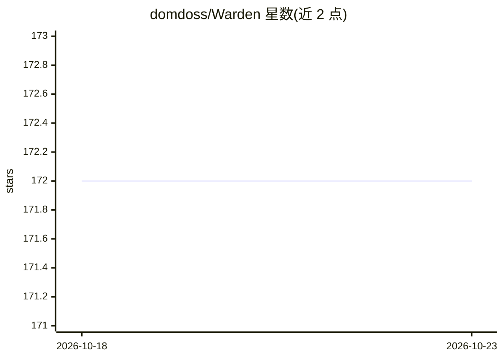

# domdoss/Warden

⭐ 172 · JavaScript · NOASSERTION · 推送 2026-10-21 · [GitHub](https://github.com/domdoss/Warden) · [官网](https://aionsystems.ca) · 个人维护

**驻留桌面的个人 AI 代理：本地+云端混合模型直接操作电脑**

dockbox.dev 项目的 fork。运行于用户桌面的个人 AI 助理：通过 Ollama 运行本地模型处理轻量任务，重负载交给云端模型，同会话内混合调度。单个 LLM 作为唯一对话入口，直接执行 shell 命令、浏览器控制、桌面键鼠操作、文件与邮件日历管理，并向 Iris/Vulkan/Artemis 等专职子代理委派任务。README 明确声明无沙箱、无容器，代理拥有与用户账户相同的系统权限，可编辑自身源码，作者自述存在提示注入等风险。采用确定性 churn 检测器终止循环的后台任务。

## 筛选速览

| 维度 | 判定 | 备注 |
|---|---|---|
| AI 角色 | `ai-native` | 本体是模型或模型工具 |
| 许可风险 | `none` | NOASSERTION |
| 部署形态 | `library` | 以包/库形式分发 |
| 模型依赖 | local-ok | 支持本地模型 |
| 硬件要求 | — | 无带数字的原话,不猜 |
| 安装摩擦 | `medium` | 含编译或系统依赖之一 |
| 成熟度 | `idea` | |

## 能力要点

- 单 seat 架构：一个 LLM 统一应答并直接操作浏览器/桌面/shell/文件
- 本地 Ollama 模型与云端模型在同一会话内混合使用
- 后台子代理委派 + 确定性 churn 检测器（连续 12 次只读调用注入催促，再 10 次即中止并升级）
- 任意请求先改写为自包含任务简报再委派给子代理

## 适用场景

- 让 AI 直接在本机代我完成浏览、命令执行、文件编辑等操作
- 用本地模型处理日常任务、云端模型处理重负载以控制成本
- 通过邮件、日历、多渠道与个人助理持续交互

## 场景标签

`AI 助手` `浏览器自动化` `GUI 自动化` · 领域:效率与自动化

## 证据(README 行号)

> L27: Warden is an AI agent with **the same access as your user account**. It executes shell commands, moves your mouse a
> L37: Warden is a personal AI assistant that lives on your desktop. It runs local models through Ollama for fast, private
> L43: A single LLM — **Warden**, the captain's first officer — runs the show, and it is the only thing you talk to. It bo

## 星数曲线

2026-10-18 172 → 2026-10-23 172（+0）

---
*卡片 v1 · prompt 1.4 · 生成 2026-10-22 · 置信度 low · 依据 README sha `dda543d816d0` · [字段定义](../../DATASET.md)*
