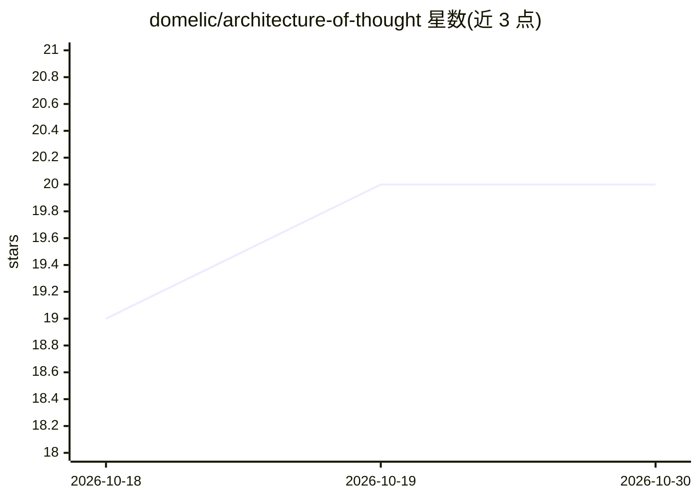

# domelic/architecture-of-thought

⭐ 20 · TeX · NOASSERTION · 推送 2026-08-03 · [GitHub](https://github.com/domelic/architecture-of-thought) · [官网](https://doi.org/10.5281/zenodo.18275169) · 个人维护

**人机协作方法论著作与 Claude Code 技能包（DCF 框架）**

The Dialectical Cognition Framework（DCF）是一套以苏格拉底式对话取代答案索取的人机协作方法论：包含 12 条核心原则、24 个思维模式、14 个反模式与自主性风险框架。以 Claude Code 技能形式交付（/dcf 苏格拉底对话、/cybw 对抗性检查点），另提供 dcf-workflow 工作流脚本与 265 页理论书（PDF/EPUB 免费下载）。安装依赖 Claude Code 作为前提，书籍部分为早期草稿状态。

## 筛选速览

| 维度 | 判定 | 备注 |
|---|---|---|
| AI 角色 | `ai-knowledge` | 知识聚合/清单类 |
| 许可风险 | `none` | NOASSERTION |
| 部署形态 | `None` |  |
| 模型依赖 | — | README 未给出锁定关系 |
| 硬件要求 | — | 无带数字的原话,不猜 |
| 安装摩擦 | `low` | 无编译、无系统依赖或容器化 |
| 成熟度 | — | 结构信号不足 |

## 能力要点

- 12 条核心原则与 24 个思维模式（5 类）
- Claude Code 技能 /dcf 与 /cybw 可通过 curl 脚本全局安装
- 14 个反模式诊断与自主性风险框架（研究文献支撑）
- 265 页书籍 PDF/EPUB 免费提供，附 LaTeX 源码

## 适用场景

- 在 Claude Code 中用苏格拉底对话审视决策与假设
- 开发者在检查点前用 /cybw 挑战 AI 回答的潜在错误
- 团队按 5 阶段手册引入 DCF 协作方法论

## 场景标签

`提示工程` · 领域:Agent 开发

## 证据(README 行号)

> L11: **What is DCF?** A methodology for working with AI that emphasizes *questioning over extraction*. Instead of "give 
> L13: DCF operates at the *micro level* of human-AI interaction—the cognitive strategy for how to think during checkpoint
> L25: **Who is this for?** Software engineers, technical writers, and knowledge workers who want to move beyond surface-l

## 星数曲线

2026-10-18 19 → 2026-10-30 20（+1）

---
*卡片 v1 · prompt 1.4 · 生成 2026-10-28 · 置信度 high · 依据 README sha `d0efe7f50aea` · [字段定义](../../DATASET.md)*
