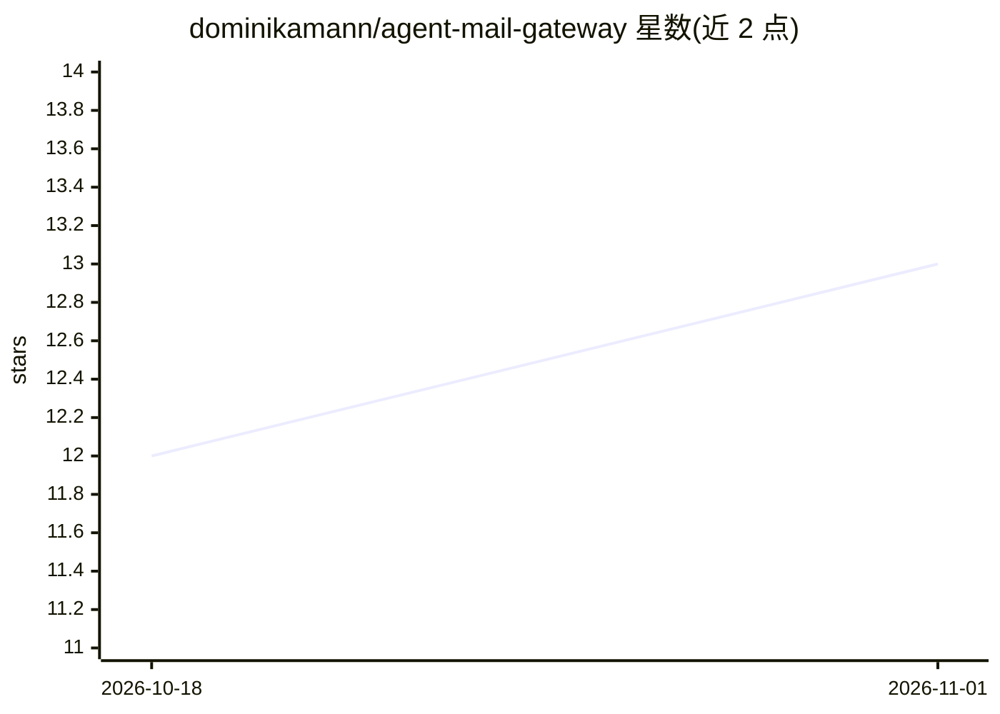

# dominikamann/agent-mail-gateway

⭐ 13 · TypeScript · MIT · 推送 2026-10-24 · [GitHub](https://github.com/dominikamann/agent-mail-gateway) · 个人维护

**给 AI agent 分配独立受控邮箱的自托管 MCP/REST 网关**

单容器自托管服务，位于 AI agent 与现有邮件服务器之间：每个 agent 持有一个 API key 对应一个 IMAP/SMTP 邮箱，通过 MCP（Streamable HTTP 或 stdio 桥）或 REST API 收发邮件、处理附件与日历邀请。安全机制包括收发件人白名单、发信前规则/可选 LLM/自然语言策略三层审查、危险附件与病毒扫描、提示注入检查；邮件以 Markdown 交付以减少 token。状态存于本地 SQLite，邮件保留在原邮件服务器上。提供 Hermes Agent 插件与签名 webhook。

## 筛选速览

| 维度 | 判定 | 备注 |
|---|---|---|
| AI 角色 | `ai-ecosystem` | LLM/agent 周边工具 |
| 许可风险 | `permissive` | MIT |
| 部署形态 | `self-host` | docker 或自建部署 |
| 模型依赖 | local-ok | 支持本地模型 |
| 硬件要求 | — | 无带数字的原话,不猜 |
| 安装摩擦 | `low` | 无编译、无系统依赖或容器化 |
| 成熟度 | — | 结构信号不足 |

## 能力要点

- 每 agent 一个 API key 仅对应一个邮箱，密码不交给 agent
- 发信前三层审查：内置规则（默认开启）/可选 LLM 审查/自然语言策略
- 收件检查：危险附件、ClamAV 病毒扫描、提示注入检测（可 hide/flag/off）
- HTML↔Markdown 转换、附件/PDF/图片转文本、完整的日历邀请工具集

## 适用场景

- 让 AI agent 在不掌握邮箱密码的前提下收发邮件
- 对 agent 发出的邮件按自定义策略做发送前把关
- 限制 agent 只能与白名单联系人通信并审计全部发送记录

## 场景标签

 · 领域:AI agent 基础设施/邮件

## 证据(README 行号)

> L15: Agent Mail Gateway is a small self-hosted service (one Docker container) that sits between your
> L21: Agents talk to it over **MCP** (Model Context Protocol) or a plain **REST API**. Mail arrives as
> L74: - MCP over Streamable HTTP, a stdio bridge for stdio-only clients, and a REST API with

## 星数曲线

2026-10-18 12 → 2026-11-01 13（+1）

---
*卡片 v1 · prompt 1.4 · 生成 2026-11-01 · 置信度 high · 依据 README sha `ef8ce8a63323` · [字段定义](../../DATASET.md)*
