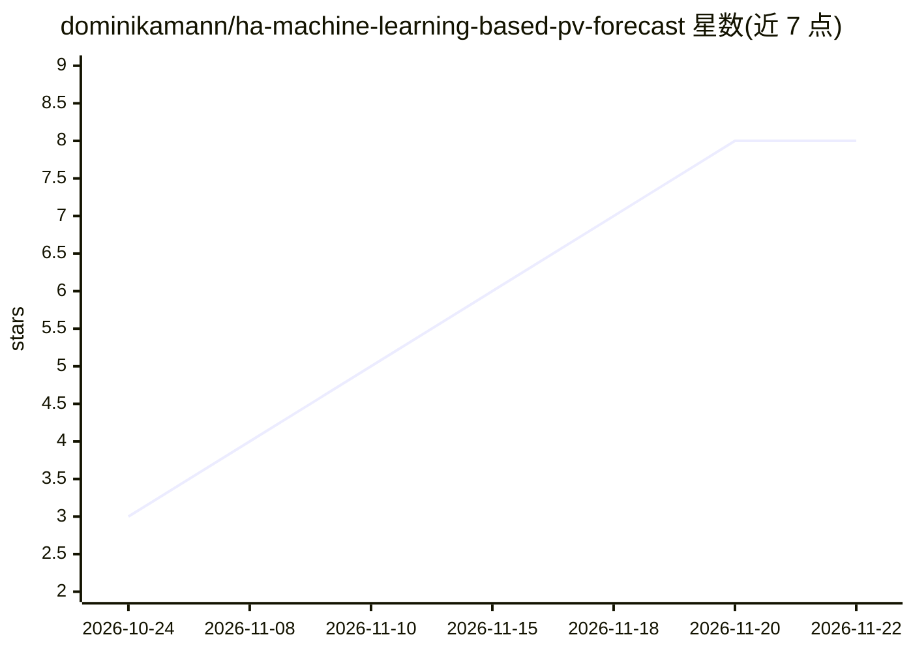

# dominikamann/ha-machine-learning-based-pv-forecast

⭐ 8 · Python · MIT · 推送 2026-11-17 · [GitHub](https://github.com/dominikamann/ha-machine-learning-based-pv-forecast) · 个人维护

**从自有发电历史学习的 Home Assistant 光伏发电量预测集成**

以 Home Assistant 集成（HACS）形式运行的光伏预测组件：读取 recorder 中用户已有的发电传感器历史，结合 Open-Meteo 多个气象模型的数据，按电站训练 histogram gradient boosting 分位数模型，输出 30 分钟至 72 小时的 P10/P50/P90 预测，接入 Energy dashboard 并提供 evcc 格式端点。每夜做误差校正与区间校准，每周日重训并在四种模型变体间自动选择；因 Home Assistant OS 无法安装 scikit-learn，boosting 采用 numpy 自实现，依赖 scipy。

## 筛选速览

| 维度 | 判定 | 备注 |
|---|---|---|
| AI 角色 | `ai-native` | 本体是模型或模型工具 |
| 许可风险 | `permissive` | MIT |
| 部署形态 | `None` |  |
| 模型依赖 | — | README 未给出锁定关系 |
| 硬件要求 | — | 无带数字的原话,不猜 |
| 安装摩擦 | `low` | 无编译、无系统依赖或容器化 |
| 成熟度 | — | 结构信号不足 |

## 能力要点

- 逐电站训练的 histogram gradient boosting 分位数模型（P10/P50/P90），无需倾角、方位角或 kWp 参数
- 读取 5 个气象模型（Open-Meteo、DWD ICON、Météo-France、ECMWF、NOAA GFS）并输出区间宽度随模型分歧变化
- 每夜误差校正与每周重训练，新模型仅在度量更优时替换旧模型
- 提供 Energy dashboard 展示与 evcc 格式 API 端点

## 适用场景

- 为家庭光伏电站生成未来 30 分钟至 72 小时的发电量预测
- 在 Home Assistant Energy dashboard 中展示太阳能预测曲线
- 为 evcc 提供本地光伏预测数据以配合充电调度

## 场景标签

 · 领域:智能家居/能源预测

## 证据(README 行号)

> L12: **A PV forecast for Home Assistant that learns from your own history: no tilt, no azimuth, no kWp,
> L61: - **Model**: histogram gradient boosting per plant with quantile outputs (P10/P50/P90); recent
> L64:  The boosting is a small numpy implementation of the algorithm behind scikit-learn's
> L66:  Home Assistant OS. The only extra dependency is scipy.

## 星数曲线

2026-10-24 3 → 2026-11-22 8（+5）

---
*卡片 v1 · prompt 1.4 · 生成 2026-11-20 · 置信度 high · 依据 README sha `2ed64ad3fc27` · [字段定义](../../DATASET.md)*
