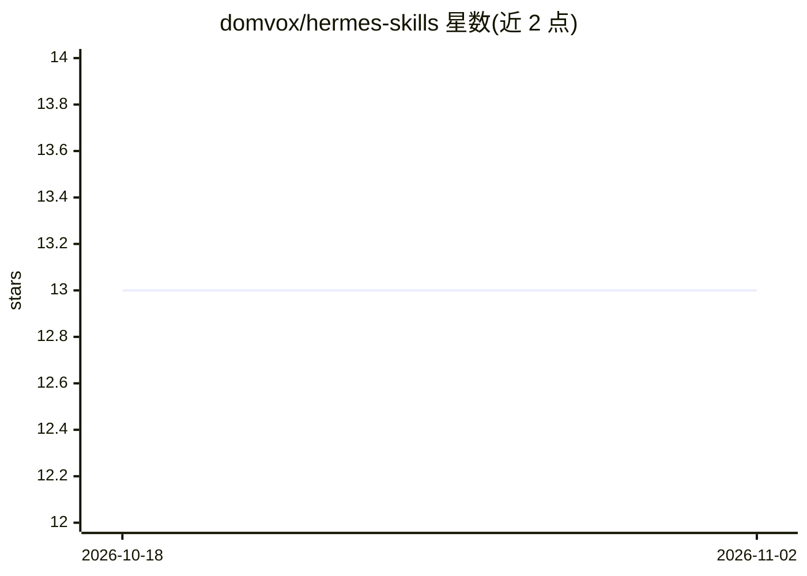

# domvox/hermes-skills

⭐ 13 · Python · MIT · 推送 2026-04-09 · [GitHub](https://github.com/domvox/hermes-skills) · 个人维护

**Hermes Agent 的可复用技能包与依赖图系统**

为 Hermes Agent 提供 3 个即装即用技能与 3 个技能图工具：bitwarden 技能通过 bws CLI 注入密钥与环境变量；email-himalaya 技能链式组合 bitwarden 与 himalaya 实现无密码邮件；skill-autoresearch 提供自动化评估循环（benchmark→diagnose→verify→patch→KEEP/REVERT）。技能通过 SKILL.md frontmatter 的 dependencies 块声明依赖（工具、环境变量、其他技能），skill-graph-test 端到端验证并扫描 PII，skill-graph-viz 生成 PNG 依赖图，skill-graph-extract 分析会话历史建议新技能。安装方式为复制目录到 ~/.hermes/skills/。

## 筛选速览

| 维度 | 判定 | 备注 |
|---|---|---|
| AI 角色 | `ai-ecosystem` | LLM/agent 周边工具 |
| 许可风险 | `permissive` | MIT |
| 部署形态 | `None` |  |
| 模型依赖 | — | README 未给出锁定关系 |
| 硬件要求 | — | 无带数字的原话,不猜 |
| 安装摩擦 | `low` | 无编译、无系统依赖或容器化 |
| 成熟度 | — | 结构信号不足 |

## 能力要点

- bitwarden/email-himalaya/skill-autoresearch 三个即装即用技能
- SKILL.md frontmatter 声明依赖的技能依赖图系统
- skill-graph-test 端到端组合测试与 PII 扫描
- skill-graph-extract 从会话历史中建议新技能

## 适用场景

- 给 Hermes Agent 添加密钥管理与无密码邮件能力
- 验证自定义技能的工具与环境变量依赖
- 从使用习惯中发现可封装为新技能的常用工具

## 场景标签

`Agent 框架` `模型评测` · 领域:Agent 开发

## 证据(README 行号)

> L3: Reusable skills and a dependency graph system for Hermes Agent.
> L7: **3 skills** you can drop into `~/.hermes/skills/` and use immediately, plus **3 tools** that verify dependencies, v

## 星数曲线

2026-10-18 13 → 2026-11-02 13（+0）

---
*卡片 v1 · prompt 1.4 · 生成 2026-10-31 · 置信度 high · 依据 README sha `5818457776fd` · [字段定义](../../DATASET.md)*
