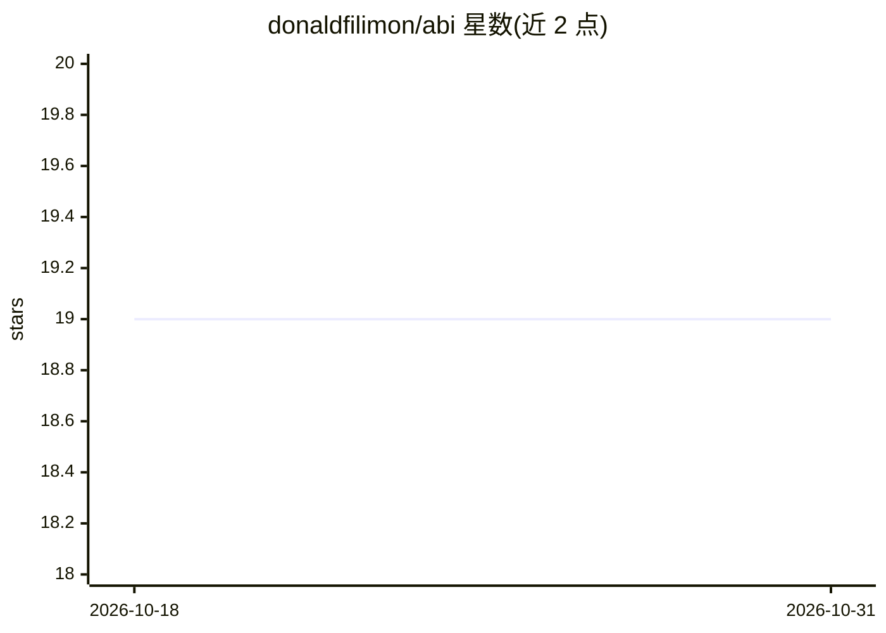

# donaldfilimon/abi

⭐ 19 · JavaScript · Apache-2.0 · 推送 2026-10-27 · [GitHub](https://github.com/donaldfilimon/abi) · [官网](https://donaldfilimon.github.io/abi/) · 个人维护

**Rust 编写的本地 AI 运行时与编排框架（路由/治理/CLI/MCP）**

ABI 是 Rust 2024（1.99.1）实现的本地 AI 运行时与集成框架，提供确定性 profile 路由、agent 与工具契约、provider 连接器、模型工件基础及 CLI/MCP 接口。构建依赖兄弟仓库 WDBX 的精确修订版本；通过 ./tools/cargo.sh 脚本构建 abi-cli 与 abi-mcp，主要验证门槛为 ./tools/check.sh。仓库附有能力边界表，明示训练权重、多主机生产运行、CUDA/Vulkan 执行等多项能力尚未证实；基准面板使用合成数据。面向开发者与研究人员。

## 筛选速览

| 维度 | 判定 | 备注 |
|---|---|---|
| AI 角色 | `ai-ecosystem` | LLM/agent 周边工具 |
| 许可风险 | `permissive` | Apache-2.0 |
| 部署形态 | `None` |  |
| 模型依赖 | — | README 未给出锁定关系 |
| 硬件要求 | — | 无带数字的原话,不猜 |
| 安装摩擦 | `medium` | 含编译或系统依赖之一 |
| 成熟度 | `idea` | |

## 能力要点

- CLI/MCP 双接口：stdio JSON-RPC 为主契约，附 MCP 2024-11-05 HTTP+SSE 兼容监听
- 12 个冻结 MCP 工具（ai_run/ai_complete/wdbx_query/gpu_status 等）
- deny-by-default 的请求级能力内核与 agent 主机的策略/审计组合
- 账户与节点注册研究服务：OIDC 登录、节点配对、加密推理中继

## 适用场景

- 本地编排与治理 AI agent 请求，做显式授权与审计
- 通过 MCP 协议将 CLI 能力暴露给 agent 客户端
- 配合 WDBX 做带持久化与向量检索的本地补全/学习实验

## 场景标签

`Agent 框架` · 领域:Agent 开发

## 证据(README 行号)

> L6: ABI is the local AI runtime and integration framework behind the existing Abbey
> L8: contracts, provider connectors, model-artifact foundations, and a CLI/MCP
> L32: |**ABI**|Dynamic moderation/routing and execution governance.|Current executable behavior is defined by this reposi

## 星数曲线

2026-10-18 19 → 2026-10-31 19（+0）

---
*卡片 v1 · prompt 1.4 · 生成 2026-10-28 · 置信度 high · 依据 README sha `e74722e29398` · [字段定义](../../DATASET.md)*
