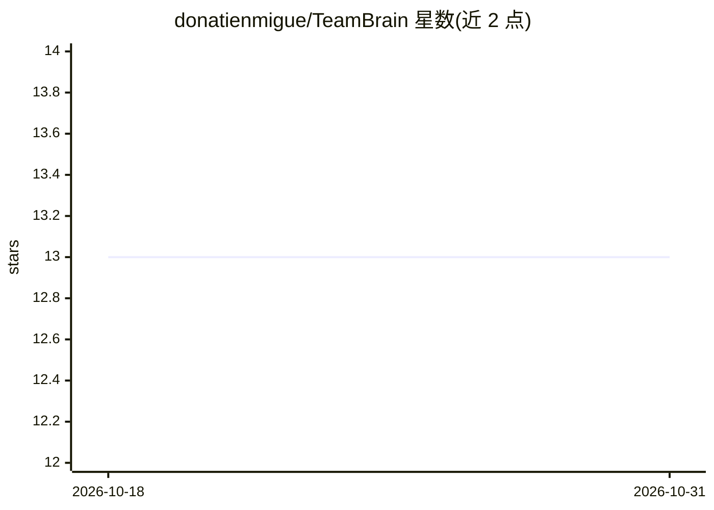

# donatienmigue/TeamBrain

⭐ 13 · TypeScript · Apache-2.0 · 推送 2026-08-14 · [GitHub](https://github.com/donatienmigue/TeamBrain) · [官网](https://donatienmigue.github.io/TeamBrain/) · 个人维护

**面向团队 AI 编程 agent 的 Git 原生共享记忆系统**

以 Git 仓库中的 markdown 文件（带 YAML front-matter）作为团队共享记忆，通过本地守护进程建立 SQLite+FTS5+本地 ONNX 嵌入索引，以 MCP 服务器形式向 Claude Code、Cursor、Codex、Gemini CLI 等 agent 提供记忆检索。会话事件在设备端脱敏后推送至独立分支，CI 中的 distiller 用用户自己的 LLM key 从会话模式草拟候选记忆并以 PR 形式提交人工审批；任何写入默认分支的操作都需经 PR。检索为本地离线混合检索（BM25+向量）。限制：单仓库、每周约 5+ 会话才能产生有效提案、Cursor/Codex 捕获能力部分缺失，支持 macOS/Linux（Windows 原生可运行但覆盖较少）。

## 筛选速览

| 维度 | 判定 | 备注 |
|---|---|---|
| AI 角色 | `ai-ecosystem` | LLM/agent 周边工具 |
| 许可风险 | `permissive` | Apache-2.0 |
| 部署形态 | `library` | 以包/库形式分发 |
| 模型依赖 | — | README 未给出锁定关系 |
| 硬件要求 | — | 无带数字的原话,不猜 |
| 安装摩擦 | `low` | 无编译、无系统依赖或容器化 |
| 成熟度 | — | 结构信号不足 |

## 能力要点

- 记忆为仓库内 markdown 文件，git clone 即完整导出，无服务器/数据库/账号
- 本地离线混合检索（FTS5 BM25 + 向量倒数排序融合），读取记忆不调用 API
- 写入须经 PR 人工审批，retire 同样走 PR 流程
- 设备端脱敏（secrets/PII/熵扫描）+ 出口流量扫描测试，网络调用限定四处

## 适用场景

- 团队让多个 AI 编程 agent 共享踩坑记录、约定与决策
- 把 CLAUDE.md/.cursorrules 式的手工维护文件替换为可审计、可回滚的记忆库
- 从会话元数据中蒸馏候选记忆并经 PR 审核沉淀

## 场景标签

`Agent 记忆` · 领域:Agent 开发

## 证据(README 行号)

> L5: Git-native memory that Claude Code, Cursor, and any MCP-capable agent read from — and that your team writes to the s
> L69: ## How it works
> L73: **Capturing.** Thin hooks emit metadata about what the session did: which files were touched, which commands exited

## 星数曲线

2026-10-18 13 → 2026-10-31 13（+0）

---
*卡片 v1 · prompt 1.4 · 生成 2026-10-31 · 置信度 high · 依据 README sha `cc89d5d5d6c8` · [字段定义](../../DATASET.md)*
