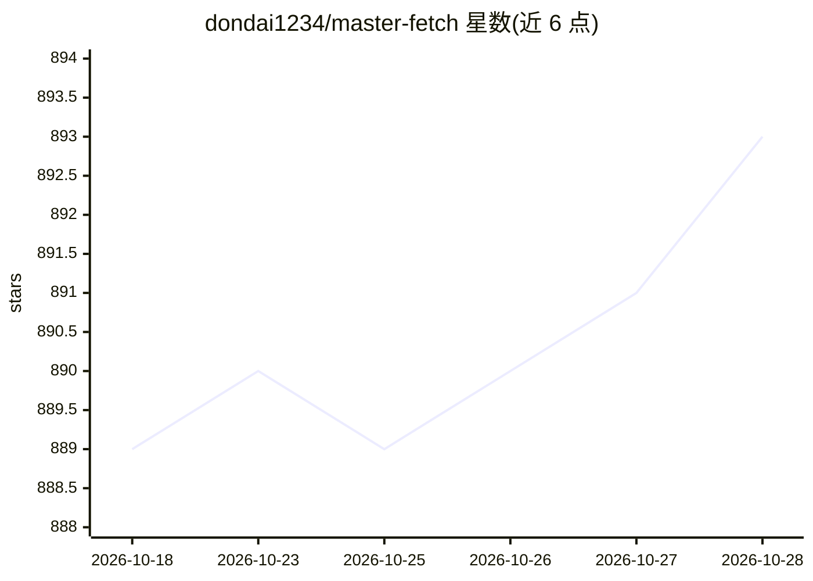

# dondai1234/master-fetch

⭐ 893 · Python · MIT · 推送 2026-07-24 · [GitHub](https://github.com/dondai1234/master-fetch) · [官网](https://hound-mcp.pages.dev) · 个人维护

**给 AI agent 用的本地网页抓取与搜索 MCP 服务器**

Hound 是一个自托管的 MCP 服务器，让任何支持 MCP 的 AI 客户端（Claude Code、Cursor、OpenCode 等）具备网页能力。提供 6 个工具：smart_fetch（HTTP 优先、被拦截时升级到反检测浏览器，支持 PDF/OCR/分页）、smart_crawl（同域爬取转 markdown）、smart_search（本地无 key 搜索，10 个后端并行、ONNX 交叉编码器重排）、screenshot、cache_clear、version。搜索为纯 HTTP 抓取公共引擎，README 声明不承诺符合搜索引擎 ToS；支持 BYOK 搜索与代理轮换。pip 或 Docker 安装，无账号无 API key。

## 筛选速览

| 维度 | 判定 | 备注 |
|---|---|---|
| AI 角色 | `ai-ecosystem` | LLM/agent 周边工具 |
| 许可风险 | `permissive` | MIT |
| 部署形态 | `desktop` | 安装包/桌面程序 |
| 模型依赖 | — | README 未给出锁定关系 |
| 硬件要求 | — | 无带数字的原话,不猜 |
| 安装摩擦 | `low` | 无编译、无系统依赖或容器化 |
| 成熟度 | — | 结构信号不足 |

## 能力要点

- 6 个 MCP 工具：抓取、爬取、无 key 本地搜索、截图等
- 10 个搜索后端并行 + 神经重排（ms-marco-MiniLM ONNX 本地运行）
- 反检测浏览器（Cloudflare Turnstile 绕过、指纹配置、人类行为模拟）
- Docker 部署与 HTTP MCP 模式、代理轮换池

## 适用场景

- 给 Claude Code/Cursor 等 MCP 客户端添加网页搜索与抓取能力
- 在服务器上以 Docker 部署共享的网页访问服务
- 无需 API key 的本地网页研究（搜索+抓取+爬取）

## 场景标签

`网页抓取` · 领域:效率与自动化

## 证据(README 行号)

> L53: Hound is one MCP server that gives any agent (Claude Code, Cursor, OpenCode, Hermes, Pi, anything that speaks MCP) 
> L61: > Hound is for the agent itself. You install it once; the agent calls it whenever it needs the web.
> L83: Hound can run in Docker with HTTP mode, ideal for:

## 星数曲线

2026-10-18 889 → 2026-10-28 893（+4）

---
*卡片 v1 · prompt 1.4 · 生成 2026-10-21 · 置信度 high · 依据 README sha `cd7e6e4151f5` · [字段定义](../../DATASET.md)*
