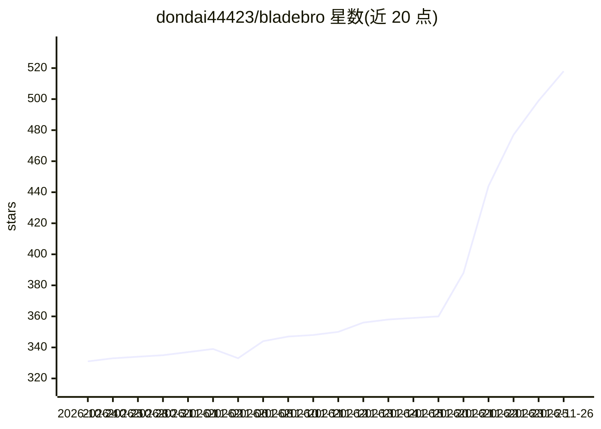

# dondai44423/bladebro

⭐ 518 · Rust · Apache-2.0 · 推送 2026-11-24 · [GitHub](https://github.com/dondai44423/bladebro) · 个人维护

**供 AI agent 或终端驱动真实浏览器的 MCP 驱动器**

以单个 Rust 二进制提供的浏览器驱动，暴露 5 个 MCP 工具（act/see/state/run/vision），支持导航、点击、填表、读取页面、会话保持与截图，CLI 与 MCP 共享同一处理器，首次调用启动本地守护进程以延续标签页与页面状态。通过 CDP 控制真实 Chromium，支持独立 agent 浏览器与接入用户已装浏览器的 real-browser 模式。仅支持 Chromium 系浏览器，不支持扩展与会话录制，交互式挑战可能返回 blocked 结果。

## 筛选速览

| 维度 | 判定 | 备注 |
|---|---|---|
| AI 角色 | `ai-ecosystem` | LLM/agent 周边工具 |
| 许可风险 | `permissive` | Apache-2.0 |
| 部署形态 | `library` | 以包/库形式分发 |
| 模型依赖 | — | README 未给出锁定关系 |
| 硬件要求 | — | 无带数字的原话,不猜 |
| 安装摩擦 | `low` | 无编译、无系统依赖或容器化 |
| 成熟度 | — | 结构信号不足 |

## 能力要点

- 5 个 MCP 工具（act/see/state/run/vision）由单个 Rust 二进制提供
- 本地守护进程保持浏览器会话与页面状态跨调用延续
- 支持独立 agent 浏览器与附加用户已装 Chromium 系浏览器的两种模式
- 交互返回 verdict 与增量，提供结构化读取与 PNG 截图

## 适用场景

- 让 MCP 客户端中的 agent 操作浏览器完成网页任务
- 在终端用 CLI 命令导航并读取网页内容
- 依赖已登录浏览器配置执行自动化操作

## 场景标签

`浏览器自动化` · 领域:效率与自动化

## 证据(README 行号)

> L5:  Drive a real browser from your agent or terminal.
> L6: Click, fill forms, read pages, and keep a browser session across calls. Five MCP tools in one Rust binary.
> L89: **Agent or CLI → Bladebro → Chromium DevTools Protocol → live browser.**

## 星数曲线

2026-10-24 331 → 2026-11-26 518（+187）

---
*卡片 v1 · prompt 1.4 · 生成 2026-11-25 · 置信度 high · 依据 README sha `789f4f5b626a` · [字段定义](../../DATASET.md)*
