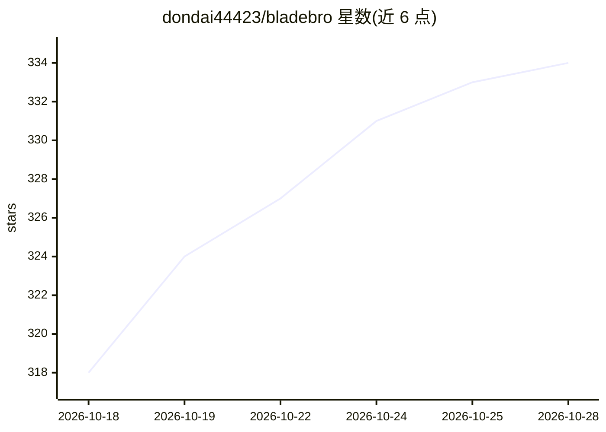

# dondai44423/bladebro

⭐ 334 · Rust · Apache-2.0 · 推送 2026-10-27 · [GitHub](https://github.com/dondai44423/bladebro) · 个人维护

**给 AI agent 用的 Rust 浏览器驱动：MCP/CLI，5 工具全控真实浏览器**

Rust 编写的 agentic 浏览器驱动，以单一 MCP server 与 CLI 形式向 AI agent 提供 5 个工具（act/see/state/run/vision），基于自建 CDP 传输，产出单一静态二进制，无 Node.js/Playwright 运行时。跨工具调用维护持久 Live Page Model，每次动作返回页面增量而非整页快照；引用（refs）通过结构指纹在 React/Vue/Angular 重渲染后存活。默认开启 6 层隐身，`rb on` 可改用用户自己的 Chromium 系浏览器。通过 npm 分发各平台预编译二进制，需本机安装 Chrome/Chromium；也可源码编译（Rust 1.86+）。提供 Pi、DSH、Hermes 等接入方式。

## 筛选速览

| 维度 | 判定 | 备注 |
|---|---|---|
| AI 角色 | `ai-ecosystem` | LLM/agent 周边工具 |
| 许可风险 | `permissive` | Apache-2.0 |
| 部署形态 | `desktop` | 安装包/桌面程序 |
| 模型依赖 | — | README 未给出锁定关系 |
| 硬件要求 | — | 无带数字的原话,不猜 |
| 安装摩擦 | `medium` | 含编译或系统依赖之一 |
| 成熟度 | — | 结构信号不足 |

## 能力要点

- 5 个 MCP 工具（act/see/state/run/vision），工具定义约 1,900 tokens
- 每次动作返回页面增量（60–570 tokens），非整页快照
- refs 经结构指纹在框架重渲染后存活，死引用自动重解析
- `rb on` 切换到用户自己的 Chromium 系浏览器（注入层关闭）

## 适用场景

- 让 AI agent 操作真实浏览器完成登录、点击、表单、抓取等任务
- 在反爬网站（如 Reddit、X.com）上获取结构化内容
- 以低 token 开销将浏览器能力接入 MCP 兼容的 agent 框架

## 场景标签

`浏览器自动化` `网页抓取` · 领域:效率与自动化

## 证据(README 行号)

> L19: **Bladebro is an agentic browser driver** — it gives an AI agent full control of a real browser through **5 tools**
> L108: DSH discovers the five tools as `mcp__bladebro__act`, `see`, `state`, `run` and

## 星数曲线

2026-10-18 318 → 2026-10-28 334（+16）

---
*卡片 v1 · prompt 1.4 · 生成 2026-10-21 · 置信度 high · 依据 README sha `433bb7512f00` · [字段定义](../../DATASET.md)*
