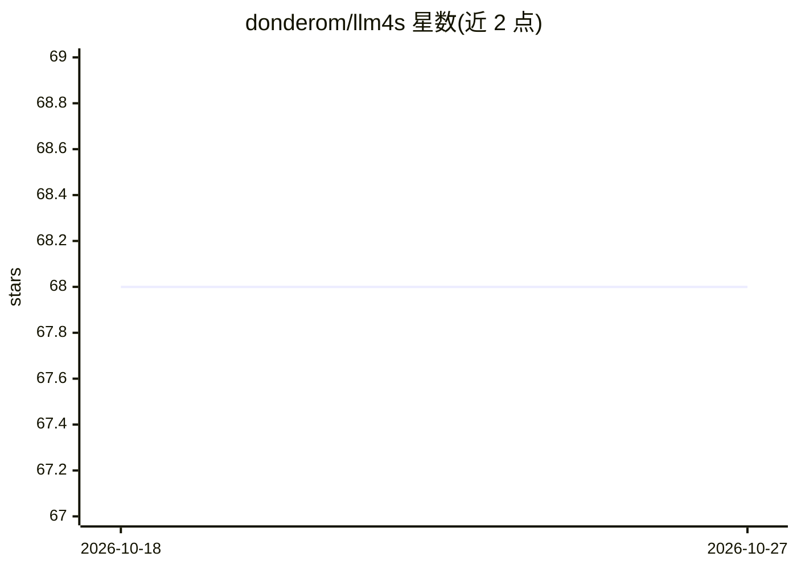

# donderom/llm4s

⭐ 68 · Scala · Apache-2.0 · 推送 2026-10-05 · [GitHub](https://github.com/donderom/llm4s) · 个人维护

**llama.cpp 的 Scala 3 绑定库，供 JVM 上运行本地模型**

基于 Slinc 的 Scala 3 绑定库，通过 JVM 的外部函数访问机制（jdk.incubator.foreign）调用 llama.cpp，使 Scala/JVM 项目能在进程内加载 GGUF 模型进行文本补全与向量嵌入生成。要求 Scala 3.3.0 与 JDK 17/19，版本号后缀对应所支持的 llama.cpp release（如 b10273）。自述为实验性项目，提供 Maven Central 依赖引入与 scala-cli 自包含示例，模型行为通过 ModelParams、LlmParams、EmbeddingParams 三类入口配置。

## 筛选速览

| 维度 | 判定 | 备注 |
|---|---|---|
| AI 角色 | `ai-ecosystem` | LLM/agent 周边工具 |
| 许可风险 | `permissive` | Apache-2.0 |
| 部署形态 | `None` |  |
| 模型依赖 | — | README 未给出锁定关系 |
| 硬件要求 | — | 无带数字的原话,不猜 |
| 安装摩擦 | `medium` | 含编译或系统依赖之一 |
| 成熟度 | `idea` | |

## 能力要点

- 通过 Slinc 与 JVM incubator foreign 模块绑定 llama.cpp
- 支持文本补全生成与嵌入（embeddings）输出
- 提供 scala-cli 自包含运行示例（Llama 3、gpt-oss、Qwen3.8）
- 版本号后缀跟踪所支持的 llama.cpp release

## 适用场景

- 在 Scala/JVM 项目中本地加载 GGUF 模型做补全
- 用 Scala 生成文本嵌入向量
- 以 scala-cli 单文件脚本快速试验本地模型

## 场景标签

`推理引擎` · 领域:训练与推理

## 证据(README 行号)

> L10: *Experimental* Scala 3 bindings for llama.cpp using Slinc.
> L53: #### Completion
> L62: #### Embeddings

## 星数曲线

2026-10-18 68 → 2026-10-27 68（+0）

---
*卡片 v1 · prompt 1.4 · 生成 2026-10-24 · 置信度 high · 依据 README sha `57f829badb5f` · [字段定义](../../DATASET.md)*
