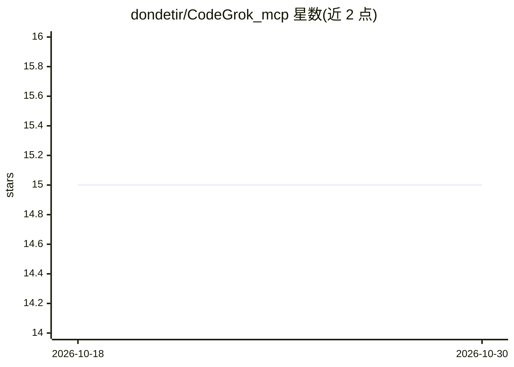

# dondetir/CodeGrok_mcp

⭐ 15 · Python · NOASSERTION · 推送 2026-03-15 · [GitHub](https://github.com/dondetir/CodeGrok_mcp) · 个人维护

**让 AI 助手语义检索代码库的 MCP 服务器**

CodeGrok MCP 是一个 Model Context Protocol 服务器，供 Claude、Cursor、Cline 等 MCP 客户端连接使用。它用 Tree-sitter 解析 9 种语言的代码，抽取函数、类、方法等符号并切分语义块，经 sentence-transformers 生成向量后存入本地 ChromaDB；AI 助手通过 learn（索引）与 get_sources（语义检索）等 4 个工具查询代码，只返回最相关的少量代码片段以减少 token 消耗。全部数据保存在本地 .codegrok/ 目录，无需 LLM API key。限制：只读检索，不执行代码、不支持跨仓库搜索，首次索引约 50 chunks/秒，嵌入模型占用 500MB-2GB 内存，首次运行需从 HuggingFace 下载约 500MB 模型。

## 筛选速览

| 维度 | 判定 | 备注 |
|---|---|---|
| AI 角色 | `ai-ecosystem` | LLM/agent 周边工具 |
| 许可风险 | `permissive` | NOASSERTION |
| 部署形态 | `None` |  |
| 模型依赖 | — | README 未给出锁定关系 |
| 硬件要求 | — | 无带数字的原话,不猜 |
| 安装摩擦 | `medium` | 含编译或系统依赖之一 |
| 成熟度 | — | 结构信号不足 |

## 能力要点

- Tree-sitter 解析 9 种语言、28 种文件扩展名并抽取符号
- learn/get_sources 等 4 个 MCP 工具，支持增量索引与 load_only 模式
- 向量存入本地 ChromaDB（.codegrok/ 目录），无需 LLM API key
- 自动检测 CUDA 加速嵌入计算

## 适用场景

- AI 编程助手在有限上下文内检索大代码库的相关代码
- 接手新项目时用自然语言定位入口点、认证逻辑、数据库层
- 代码评审时让 AI 查找用户输入处理与错误处理的位置

## 场景标签

`语义搜索` · 领域:知识与检索

## 证据(README 行号)

> L15: CodeGrok MCP is a **Model Context Protocol (MCP) server** that enables AI assistants to intelligently search and un
> L28: **The Solution:** CodeGrok indexes your code once, then AI can query semantically and receive only the 5-10 most re
> L294: CodeGrok provides **4 tools** for AI assistants:

## 星数曲线

2026-10-18 15 → 2026-10-30 15（+0）

---
*卡片 v1 · prompt 1.4 · 生成 2026-10-30 · 置信度 high · 依据 README sha `d7239377d74f` · [字段定义](../../DATASET.md)*
