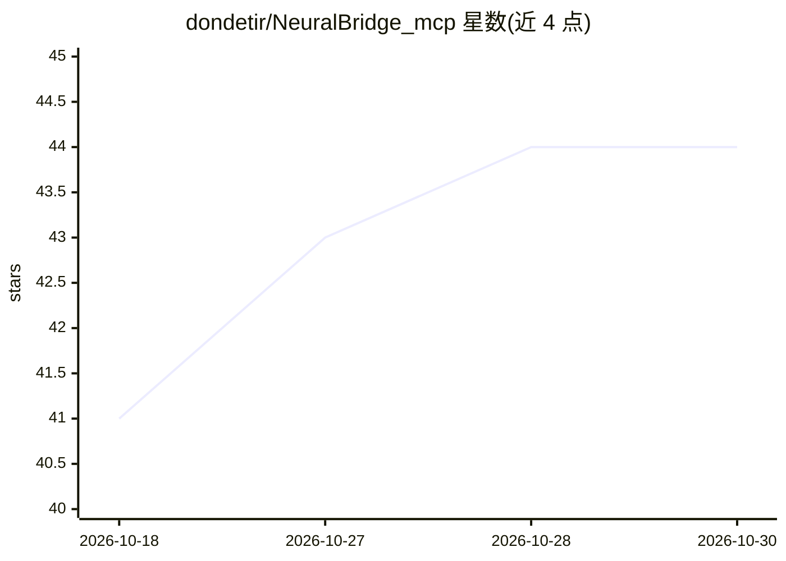

# dondetir/NeuralBridge_mcp

⭐ 44 · Kotlin · NOASSERTION · 推送 2026-03-16 · [GitHub](https://github.com/dondetir/NeuralBridge_mcp) · [官网](https://dondetir.github.io/NeuralBridge_mcp/) · 个人维护

**MCP 服务器：让 AI agent 直接控制 Android 设备执行自动化操作**

运行在 Android 设备上的 MCP 服务器（Apache 2.0，v0.4.0，Kotlin 实现）：通过 AccessibilityService 在设备进程内执行操作，AI agent 经 HTTP/MCP 直连配套 App，无需 root 与 ADB。提供 32 个 MCP 工具，覆盖点击、滑动、输入、应用管理、截图、UI 树读取等，README 报告平均操作延迟 6.4ms。面向为 AI agent 提供 Android 控制能力的开发者；构建需 Android SDK（API 24+）与 JDK 17，设备需 Android 7.0+，Android 15+ 需额外开启受限设置。

## 筛选速览

| 维度 | 判定 | 备注 |
|---|---|---|
| AI 角色 | `ai-ecosystem` | LLM/agent 周边工具 |
| 许可风险 | `none` | NOASSERTION |
| 部署形态 | `None` |  |
| 模型依赖 | — | README 未给出锁定关系 |
| 硬件要求 | — | 无带数字的原话,不猜 |
| 安装摩擦 | `medium` | 含编译或系统依赖之一 |
| 成熟度 | — | 结构信号不足 |

## 能力要点

- AccessibilityService 进程内执行，去 ADB 与 IPC 环节
- 32 个 MCP 工具：点击/滑动/输入/应用管理/截图/UI 树读取
- 无需 root，agent 经 HTTP 直连设备上的配套 App
- README 给出与 Appium/Maestro/mobile-mcp 等的延迟对比数据

## 适用场景

- 让 Claude/GPT/Gemini 等 agent 直接操控我的 Android 设备
- 为 AI agent 搭建 Android 自动化或测试流程
- 通过自然语言指令截图、点击、输入完成设备操作

## 场景标签

`GUI 自动化` · 领域:效率与自动化

## 证据(README 行号)

> L5:  AI-native Android automation via the Model Context Protocol
> L48: Your AI agent speaks MCP over HTTP directly to the companion app — no middleware, no ADB, no intermediate server.

## 星数曲线

2026-10-18 41 → 2026-10-30 44（+3）

---
*卡片 v1 · prompt 1.4 · 生成 2026-10-25 · 置信度 high · 依据 README sha `ef3d15b6aa6c` · [字段定义](../../DATASET.md)*
