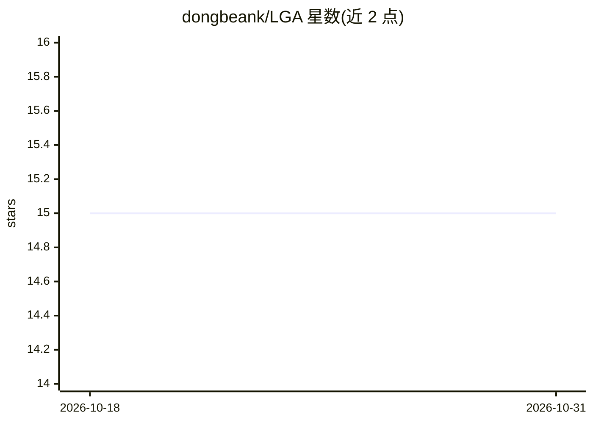

# dongbeank/LGA

⭐ 15 · Python · 推送 2026-02-24 · [GitHub](https://github.com/dongbeank/LGA) · [官网](https://openreview.net/forum?id=NCQPCxN7ds) · 组织维护

**论文官方实现：面向现实噪声的时间序列局部几何注意力模型**

ICLR 2026 论文 Local Geometry Attention (LGA) 的官方 PyTorch 实现。LGA 依据局部高斯过程理论为每个 query 学习专属距离度量，替代标准注意力的全局度量，用于时间序列预测并提升对异常值与噪声的稳健性。配套 TSRBench 基准：基于极值理论 (EVT) 在 5 个严重度级别注入现实噪声，生成损坏测试集用于训练与鲁棒性评估。提供各数据集训练脚本与噪声评估命令，数据集需从 Autoformer 下载，推荐 CUDA 兼容 GPU，CUDA 为推荐项而非强制要求。

## 筛选速览

| 维度 | 判定 | 备注 |
|---|---|---|
| AI 角色 | `ai-native` | 本体是模型或模型工具 |
| 许可风险 | `none` | — |
| 部署形态 | `library` | 以包/库形式分发 |
| 模型依赖 | — | README 未给出锁定关系 |
| 硬件要求 | — | 无带数字的原话,不猜 |
| 安装摩擦 | `medium` | 含编译或系统依赖之一 |
| 成熟度 | — | 结构信号不足 |

## 能力要点

- 基于局部高斯过程的 query 专属距离度量注意力机制
- TSRBench：基于极值理论的 5 级噪声注入鲁棒性基准
- 提供 ETT 等数据集的训练脚本与噪声环境下的评估流程

## 适用场景

- 复现论文中的时间序列预测与鲁棒性实验
- 在损坏/噪声数据上评估预测模型的稳健性
- 基于 LGA 注意力机制开展时序预测研究

## 场景标签

`模型评测` `模型训练` · 领域:评测与运维

## 证据(README 行号)

> L3: #### This repository is the official PyTorch implementation of LGA: Local Geometry Attention for Time Series Forecas
> L7: Standard attention uses **one global metric** for all queries. LGA learns a **query-specific distance metric** via l
> L16: The first robustness benchmark for time series forecasting. Uses **Extreme Value Theory (EVT)** to inject realistic

## 星数曲线

2026-10-18 15 → 2026-10-31 15（+0）

---
*卡片 v1 · prompt 1.4 · 生成 2026-10-31 · 置信度 high · 依据 README sha `29c64bdc1492` · [字段定义](../../DATASET.md)*
