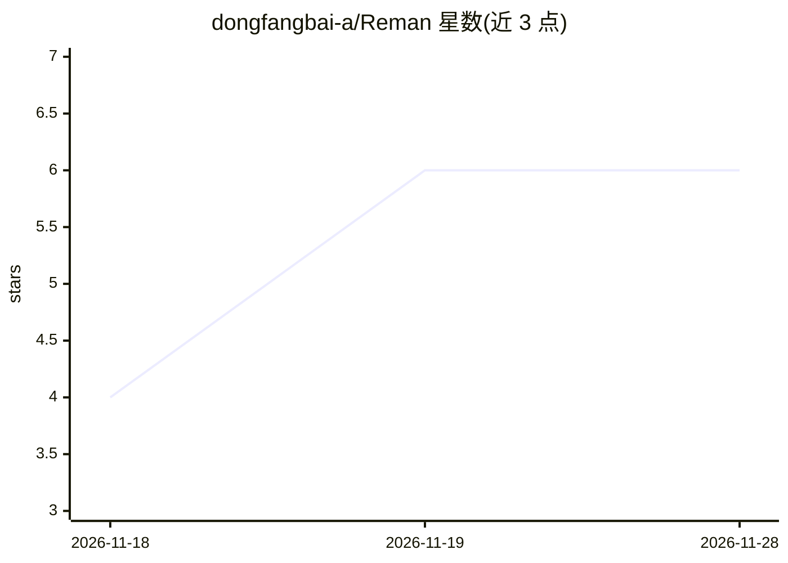

# dongfangbai-a/Reman

⭐ 6 · TypeScript · MIT · 推送 2026-11-23 · [GitHub](https://github.com/dongfangbai-a/Reman) · [官网](https://github.com/dongfangbai-a/Reman#readme) · 个人维护 · 中文 README

**浏览器网页中运行与观察多个 AI agent 协作的运行时**

Reman 是一个 AI 协作运行时：用户从网页打开即可与多个 agent 成员协作，界面提供成员页（成员列表、包含计划/命令/文件改动/测试结果的完整时间线、运行概况）与群聊视图（多个成员轮流发言、互相 @）。通过 git clone 与 npm 安装构建，Node.js 启动后默认监听本机 127.0.0.1:6001，用带令牌的链接登录后浏览器记录 Cookie。数据目录可配置，README 提示远程访问时令牌等同于运行用户的系统权限。README 自述项目仍处早期，开发周期 12 天。

## 筛选速览

| 维度 | 判定 | 备注 |
|---|---|---|
| AI 角色 | `ai-ecosystem` | LLM/agent 周边工具 |
| 许可风险 | `permissive` | MIT |
| 部署形态 | `library` | 以包/库形式分发 |
| 模型依赖 | — | README 未给出锁定关系 |
| 硬件要求 | — | 无带数字的原话,不猜 |
| 安装摩擦 | `low` | 无编译、无系统依赖或容器化 |
| 成熟度 | `idea` | |

## 能力要点

- 网页端多成员协作视图：时间线、计划与运行概况、群聊 @ 机制
- npm 一键安装构建，默认监听本机 127.0.0.1:6001，令牌换 Cookie 登录
- 提供 HTTP 接口与事件流（API.md）及基准测试文档（BENCHMARKS.md）
- 数据目录可自定义（--data-dir），README 说明安全边界

## 适用场景

- 在浏览器中同时观察和协作多个 AI agent 的执行过程
- 对比多个 agent 脚手架在同一模型下的用时与花费
- 本地部署一套多 agent 协作环境并接入自己的工具链

## 场景标签

`多智能体` `代码生成` · 领域:Agent 开发

## 证据(README 行号)

> L9: 直观高效的 AI 协作运行时。打开网页即可开始协作，过程一眼可见；同样的任务，跑得更快、花得更少。
> L15: 群聊：多个成员在一个群里轮流发言、互相 @，右边是计划和运行概况
> L34: 运行时只监听本机。一旦要从别处访问——局域网、Tailscale、Cloudflare 隧道这些——**访问令牌就等于运行运行时的那个系统用户的完整权限**（能开终端、执行命令、改文件），谁拿到令牌谁就有这份权限。详见 CONFI

## 星数曲线

2026-11-18 4 → 2026-11-28 6（+2）

---
*卡片 v1 · prompt 1.4 · 生成 2026-11-20 · 置信度 high · 依据 README sha `aa3b8dbc2792` · [字段定义](../../DATASET.md)*
