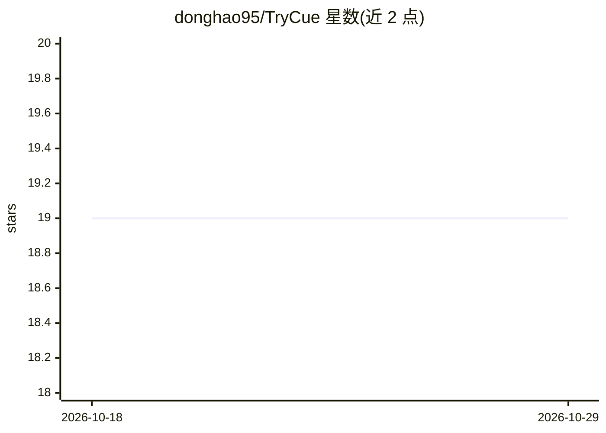

# donghao95/TryCue

⭐ 19 · TypeScript · Apache-2.0 · 推送 2026-09-25 · [GitHub](https://github.com/donghao95/TryCue) · 个人维护 · 中文 README

**发布前把内容交给一组 AI 观众模拟试映并生成报告**

AI 内容试映工作台：用户输入标题、正文和图片，系统生成观众采样计划与不同身份偏好的 AI 观众人设，试映现场模拟打开、停留、点赞、收藏、评论、分享和离开等行为并持久化为证据，最终生成内容表现、人群反应、风险提示和修改建议报告。不连接真实社交平台、不操作真实 DOM。默认 mock 模式无需 API Key，real 模式接入 OpenAI-compatible 端点。TypeScript monorepo，提供 Docker 与本地开发两种启动方式。面向内容创作者、产品运营、创业者和 Agent 开发研究者。

## 筛选速览

| 维度 | 判定 | 备注 |
|---|---|---|
| AI 角色 | `ai-native` | 本体是模型或模型工具 |
| 许可风险 | `permissive` | Apache-2.0 |
| 部署形态 | `self-host` | docker 或自建部署 |
| 模型依赖 | — | README 未给出锁定关系 |
| 硬件要求 | — | 无带数字的原话,不猜 |
| 安装摩擦 | `low` | 无编译、无系统依赖或容器化 |
| 成熟度 | — | 结构信号不足 |

## 能力要点

- 生成观众采样计划与可审核的 AI 观众人设
- 模拟 8 种行为（打开/停留/点赞/收藏/分享/评论/点赞评论/离开）并持久化为证据链
- 汇总行为与评论证据生成试映报告（表现/人群反应/风险/建议）
- mock 模式无需 LLM API Key 即可本地体验完整流程

## 适用场景

- 内容发布前检查标题、封面、正文与评论风险
- 验证内容表达、卖点与不同人群的反馈
- 研究多 Agent 行为模拟与证据链报告的工作流

## 场景标签

`多智能体` · 领域:Agent 开发

## 证据(README 行号)

> L5: 把一篇社交内容草稿发布到一个模拟试映现场，观察不同观众如何浏览、停留、点赞、收藏、评论和离开，并基于完整行为证据生成反馈报告。
> L141: |实时试映|观察观众打开、停留、点赞、收藏、评论、分享和离开|
> L146: |real 模式|接入 OpenAI-compatible 模型，验证更真实的 Agent 行为质量|

## 星数曲线

2026-10-18 19 → 2026-10-29 19（+0）

---
*卡片 v1 · prompt 1.4 · 生成 2026-10-28 · 置信度 mid · 依据 README sha `e847d818aed0` · [字段定义](../../DATASET.md)*
