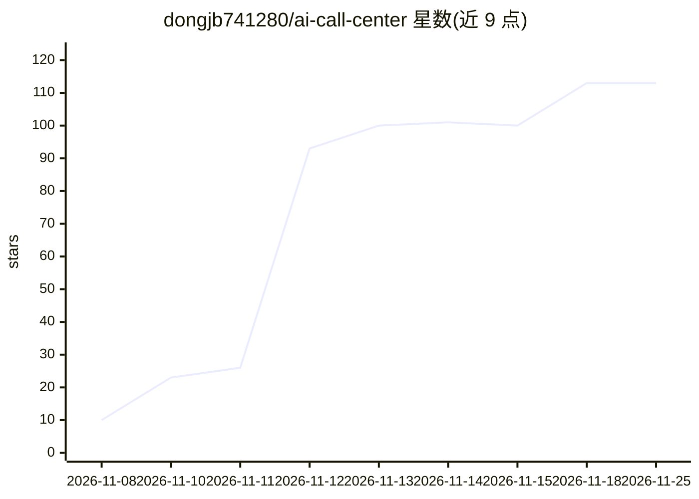

# dongjb741280/ai-call-center

⭐ 113 · Java · GPL-3.0 · 推送 2026-11-19 · [GitHub](https://github.com/dongjb741280/ai-call-center) · [官网](https://dongjb741280.github.io/ai-call-center/) · 个人维护 · 中文 README

**企业开源呼叫中心系统：人工呼入呼出与智能路由**

基于 FreeSWITCH、Spring Boot 与 Vue 3 的微服务架构呼叫中心系统，模块包括管理后台 voxai-admin、呼叫控制 voxai-call、IVR 引擎 voxai-ivr 与外呼任务引擎 voxai-dialer。功能覆盖呼入呼出、VDN/IVR 路由、ACD 多种分配策略、技能组排队、坐席状态管理、WebRTC 坐席与录音上传至 MinIO。支持多租户、多数据库与 Docker/Jib 部署，定位为大规模人工呼叫场景，也可作为 AI 无人值守呼叫的底座（另有姊妹项目 IntelliCall-Pro）。

## 筛选速览

| 维度 | 判定 | 备注 |
|---|---|---|
| AI 角色 | `ai-enhanced` | 去掉 AI 部分产品仍成立 |
| 许可风险 | `viral` | GPL-3.0 |
| 部署形态 | `self-host` | docker 或自建部署 |
| 模型依赖 | — | README 未给出锁定关系 |
| 硬件要求 | — | 无带数字的原话,不猜 |
| 安装摩擦 | `low` | 无编译、无系统依赖或容器化 |
| 成熟度 | — | 结构信号不足 |

## 能力要点

- ACD 六种坐席分配策略（最闲、最长就绪、轮询等）
- VDN 按时段路由与 IVR 流程图节点引擎
- WebRTC/SIP/手机多方式坐席登录
- Jib 免 Docker Daemon 构建镜像与双通道 CI/CD 自动部署

## 适用场景

- 搭建企业人工客服的呼入呼出与技能组路由平台
- 配置预测式外呼任务并管理坐席与录音
- 作为 AI 语音应用的电话交换底座进行二次开发

## 场景标签

 · 领域:通信/呼叫中心系统

## 证据(README 行号)

> L23: > This project is primarily intended for large-scale human inbound and outbound calling scenarios, or as the founda
> L3: 基于 FreeSWITCH、Spring Boot 和 Vue 3 的开源呼叫中心系统，支持多租户、人工呼入呼出、智能外呼任务、ACD 技能组路由、IVR、WebRTC 坐席与录音管理，适用于企业客服和外呼业务，也可作为 AI 语音

## 星数曲线

2026-11-08 10 → 2026-11-25 113（+103）

---
*卡片 v1 · prompt 1.4 · 生成 2026-11-17 · 置信度 mid · 依据 README sha `6803bae0a506` · [字段定义](../../DATASET.md)*
