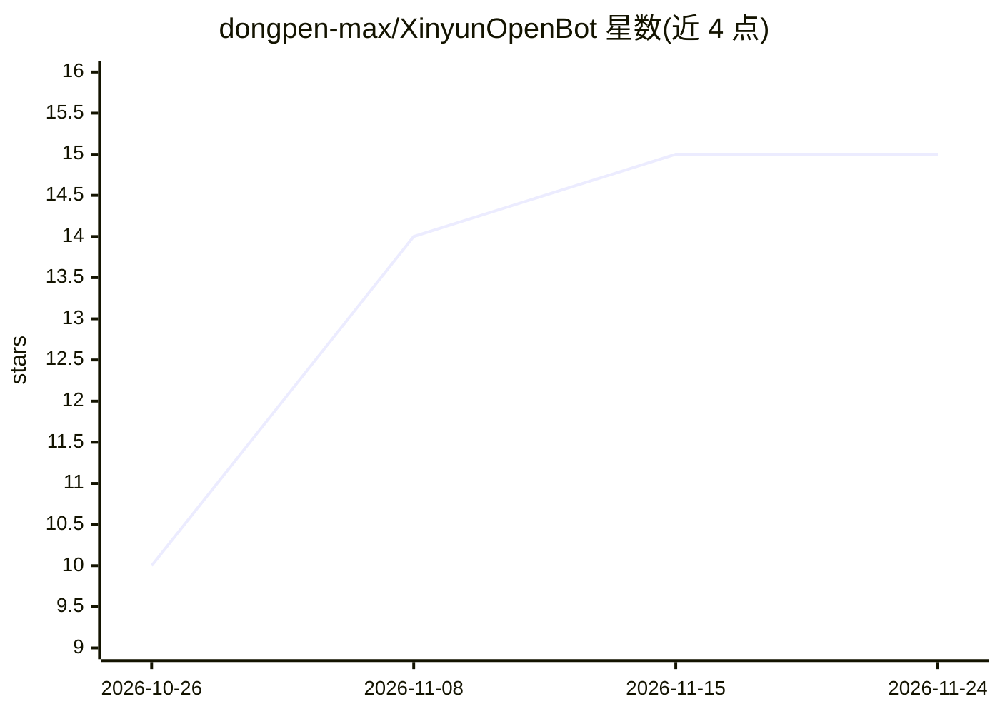

# dongpen-max/XinyunOpenBot

⭐ 15 · TypeScript · MIT · 推送 2026-08-30 · [GitHub](https://github.com/dongpen-max/XinyunOpenBot) · [官网](https://github.com/dongpen-max/xinyunopenbot-releases/releases/latest) · 个人维护 · 中文 README

**面向中国用户的多模型桌面 AI 机器人聊天客户端**

基于 Electron、React、TypeScript 的桌面应用：以聊天联系人的方式创建和管理多个机器人，每个机器人可绑定不同模型、角色、任务与声音。支持 Claude CLI、Codex CLI、Grok CLI、Gemini/Antigravity、xAI API 与 OpenAI 兼容中转站，内置 DeepSeek、智谱 GLM、通义千问、Kimi 预设。另含云桌面/本机桌面控制、多机器人群聊协作、实时语音聊天（STT/TTS）。配置与聊天记录默认保存在本机 ~/.openmausbot/。基于 OpenMausBot 开发，MIT 许可；Windows 提供安装包，macOS/Linux 需从源码运行。

## 筛选速览

| 维度 | 判定 | 备注 |
|---|---|---|
| AI 角色 | `ai-native` | 本体是模型或模型工具 |
| 许可风险 | `permissive` | MIT |
| 部署形态 | `desktop` | 安装包/桌面程序 |
| 模型依赖 | locked-api |  |
| 硬件要求 | — | 无带数字的原话,不猜 |
| 安装摩擦 | `low` | 无编译、无系统依赖或容器化 |
| 成熟度 | — | 结构信号不足 |

## 能力要点

- 多机器人管理，每机器人独立模型、角色、任务与音色
- 接入 Claude CLI / Codex CLI / Grok CLI / Gemini / xAI API / OpenAI 兼容中转站
- 内置 DeepSeek、智谱 GLM、通义千问、Kimi 国产模型预设
- 实时语音聊天：STT 转写、流式 TTS 播报、麦克风抢断

## 适用场景

- 在一个桌面应用里同时使用多家模型与国内中转站聊天
- 搭建多机器人协作的群聊房间，由总管机器人分配任务
- 用中文界面与语音方式与 AI 机器人对话

## 场景标签

`聊天机器人` `语音 Agent` · 领域:对话与助手

## 证据(README 行号)

> L7: XinyunOpen Bot 是一个基于 Electron、React 和 TypeScript 的桌面 AI 机器人管理工具。你可以像聊天联系人一样创建多个机器人，为每个机器人选择不同模型、独立任务和云端电脑，并在一个桌面应用里统
> L40: - **多模型接入**：支持 Claude CLI、Codex CLI、Grok CLI、Gemini/Antigravity、xAI API 和 OpenAI-compatible API。

## 星数曲线

2026-10-26 10 → 2026-11-24 15（+5）

---
*卡片 v1 · prompt 1.4 · 生成 2026-11-18 · 置信度 mid · 依据 README sha `07858c02e89a` · [字段定义](../../DATASET.md)*
