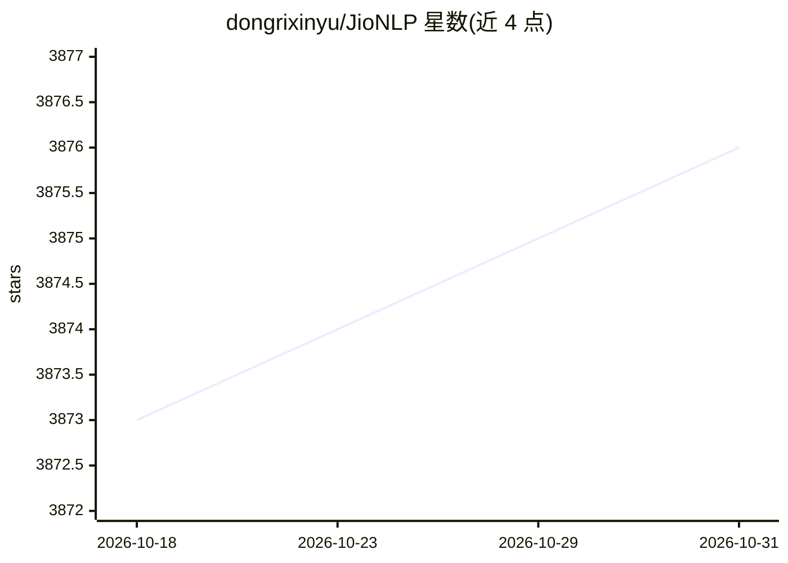

# dongrixinyu/JioNLP

⭐ 3,876 · Python · Apache-2.0 · 推送 2026-10-16 · [GitHub](https://github.com/dongrixinyu/JioNLP) · [官网](https://www.jionlp.com/) · 个人维护 · 中文 README

**面向中文 NLP 开发者的预处理与解析 Python 工具包**

以 pip 安装的 Python 库，面向 NLP 开发者，覆盖中文文本的预处理与解析：时间语义解析、地址/身份证/车牌解析、电话归属地、繁简转换、拼音与字形、正则抽取与清洗、文本数据增强（回译/同音替换等）、停用词与地名等各类词典加载、NER 与分词的标注转换及评测辅助工具，另含词典情感分析、LLM 评测数据集加载与 MELLM 自动评测算法。功能以规则与词典实现为主，用于加速 NLP 开发中的琐碎预处理环节。

## 筛选速览

| 维度 | 判定 | 备注 |
|---|---|---|
| AI 角色 | `ai-ecosystem` | LLM/agent 周边工具 |
| 许可风险 | `permissive` | Apache-2.0 |
| 部署形态 | `library` | 以包/库形式分发 |
| 模型依赖 | — | README 未给出锁定关系 |
| 硬件要求 | — | 无带数字的原话,不猜 |
| 安装摩擦 | `low` | 无编译、无系统依赖或容器化 |
| 成熟度 | — | 结构信号不足 |

## 能力要点

- 时间语义解析、地址/身份证/车牌/电话归属地等中文解析功能
- 抽取式摘要、关键短语、新词发现、文本清洗与正则抽取/删除/归一化
- 文本数据增强（回译、同音词替换、NER 实体替换等）
- NER/分词的 tag 转换、数据集切分、F1 计算等算法辅助工具与词典加载

## 适用场景

- NLP 流水线中对中文文本做清洗、分句、停用词过滤
- 解析文本中的时间、地址、身份证、金额等结构化信息
- 为序列标注/分类任务准备与矫正标注数据
- 加载停用词、地名、成语等中文词典资源

## 场景标签

`模型评测` · 领域:评测与运维

## 证据(README 行号)

> L18: - JioNLP 是一个面向 **NLP 开发者**的工具包，提供 NLP 任务预处理、解析功能，准确、高效、零使用门槛。请下拉本网页，查阅具体功能信息，并按 **Ctrl+F** 进行搜索。关注同名**微信公众号 JioNLP*
> L202: - NLP 预处理与解析至关重要，且非常耗时。jionlp 目的是辅助完成各种琐碎的预处理、解析操作，加速开发进度，把有限的精力用在思考而非 coding 上。

## 星数曲线

2026-10-18 3,873 → 2026-10-31 3,876（+3）

---
*卡片 v1 · prompt 1.4 · 生成 2026-10-21 · 置信度 high · 依据 README sha `d99ce01fd7d4` · [字段定义](../../DATASET.md)*
