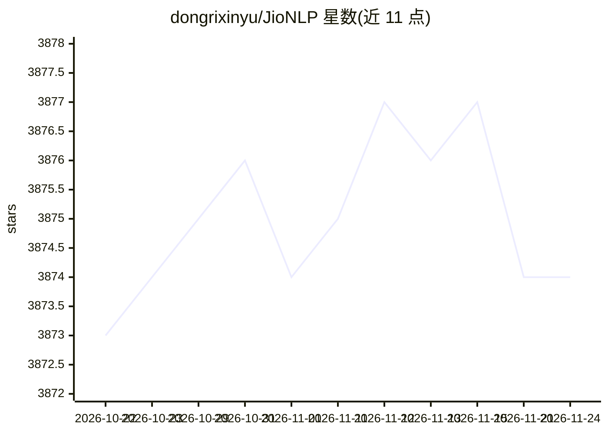

# dongrixinyu/JioNLP

⭐ 3,874 · Python · Apache-2.0 · 推送 2026-11-13 · [GitHub](https://github.com/dongrixinyu/JioNLP) · [官网](https://www.jionlp.com/) · 个人维护 · 中文 README

**给 NLP 开发者的中文文本预处理与解析工具包**

以 Python 库形式提供中文 NLP 预处理与解析能力，覆盖小工具集（车牌号/身份证/地址/时间语义解析、拼音与偏旁转换、繁简互转）、文本数据增强（回译、同音词替换等）、正则抽取与清洗、NER 辅助工具、词典加载、文本分类与情感分析辅助等九类功能。安装方式为 pip。附带 MELLM 大模型自动评测算法示例代码，及 LLM 评测数据集加载接口。面向 NLP 开发者与研究者，目标是辅助完成琐碎的预处理与解析操作。

## 筛选速览

| 维度 | 判定 | 备注 |
|---|---|---|
| AI 角色 | `ai-native` | 本体是模型或模型工具 |
| 许可风险 | `permissive` | Apache-2.0 |
| 部署形态 | `library` | 以包/库形式分发 |
| 模型依赖 | — | README 未给出锁定关系 |
| 硬件要求 | — | 无带数字的原话,不猜 |
| 安装摩擦 | `low` | 无编译、无系统依赖或容器化 |
| 成熟度 | — | 结构信号不足 |

## 能力要点

- 时间语义解析、地址解析、身份证/车牌号解析等中文结构化解析函数
- 文本数据增强：回译、同音词替换、邻近换位、实体替换
- 正则抽取与清洗工具集（抽取/删除/归一化 E-mail、URL、电话、身份证等）
- MELLM 无人工监督的 LLM 自动互评测算法与评测数据集加载器

## 适用场景

- 做中文文本挖掘前先清洗和归一化各种噪声字段
- 从地址、身份证号、电话号码字符串中解析出省市县等结构化信息
- 为 NER 或文本分类任务做标注数据增强与数据集切分
- 加载成语、地名、停用词等中文词典资源

## 场景标签

 · 领域:自然语言处理/开发工具库

## 证据(README 行号)

> L16: #### &emsp;&emsp; JioNLP：中文 NLP 预处理、解析工具包 A Python Lib for Chinese NLP Preprocessing & Parsing
> L18: - JioNLP 是一个面向 **NLP 开发者**的工具包，提供 NLP 任务预处理、解析功能，准确、高效、零使用门槛。请下拉本网页，查阅具体功能信息，并按 **Ctrl+F** 进行搜索。关注同名**微信公众号 JioNLP*
> L145: |大语言模型 LLM 评测数据集|jio.llm_test_dataset_loader|LLM 评测数据集|⭐|

## 星数曲线

2026-10-22 3,873 → 2026-11-24 3,874（+1）

---
*卡片 v1 · prompt 1.4 · 生成 2026-11-23 · 置信度 high · 依据 README sha `7a5f1dff1291` · [字段定义](../../DATASET.md)*
