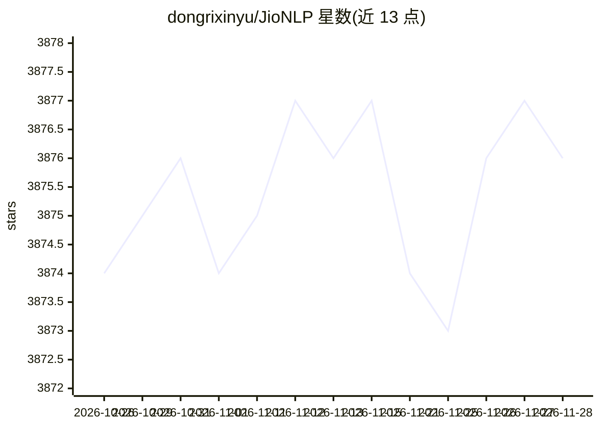

# dongrixinyu/JioNLP

⭐ 3,876 · Python · Apache-2.0 · 推送 2026-11-27 · [GitHub](https://github.com/dongrixinyu/JioNLP) · [官网](https://www.jionlp.com/) · 个人维护 · 中文 README

**面向 NLP 开发者的中文文本预处理与解析工具包**

JioNLP 是面向中文 NLP 开发者的 Python 工具包，覆盖预处理、解析与辅助建模环节：小工具集（时间语义解析、地址解析、身份证/车牌解析、拼音、繁简转换等）、文本数据增强（回译、同音替换等）、正则抽取与清洗、NER 辅助工具（词典 NER、tag 与实体互转、数据集切分）、文本分类与情感分析辅助、词典加载（成语、歇后语、中国地名、LLM 评测数据集等）。以 pip 包分发，另含 MELLM 自动评测算法示例，附 GitHub 引用格式与微信交流群。

## 筛选速览

| 维度 | 判定 | 备注 |
|---|---|---|
| AI 角色 | `ai-native` | 本体是模型或模型工具 |
| 许可风险 | `permissive` | Apache-2.0 |
| 部署形态 | `library` | 以包/库形式分发 |
| 模型依赖 | — | README 未给出锁定关系 |
| 硬件要求 | — | 无带数字的原话,不猜 |
| 安装摩擦 | `low` | 无编译、无系统依赖或容器化 |
| 成熟度 | — | 结构信号不足 |

## 能力要点

- 提供时间语义解析、地址解析、身份证/车牌/电话号码解析等中文特色功能
- 文本数据增强：回译、同音词替换、实体替换、随机增删字符
- 正则抽取与清洗：抽取/删除/归一化 E-mail、URL、电话、IP、身份证等
- 内置成语、歇后语、中国省市县地名、新华字典等多类词典加载器与 LLM 评测数据集

## 适用场景

- 为中文 NLP 任务做文本清洗、分句、停用词过滤等预处理
- 解析文本中的时间、地址、金额、身份证等结构化信息
- 用回译和实体替换扩充 NER/分类训练语料
- 加载中文词典资源辅助词典 NER 与情感分析

## 场景标签

 · 领域:自然语言处理/开发工具

## 证据(README 行号)

> L16: #### &emsp;&emsp; JioNLP：中文 NLP 预处理、解析工具包 A Python Lib for Chinese NLP Preprocessing & Parsing
> L18: - JioNLP 是一个面向 **NLP 开发者**的工具包，提供 NLP 任务预处理、解析功能，准确、高效、零使用门槛。请下拉本网页，查阅具体功能信息，并按 **Ctrl+F** 进行搜索。关注同名**微信公众号 JioNLP*
> L43: $ pip install jionlp

## 星数曲线

2026-10-26 3,874 → 2026-11-28 3,876（+2）

---
*卡片 v1 · prompt 1.4 · 生成 2026-11-28 · 置信度 high · 依据 README sha `02d15a56b097` · [字段定义](../../DATASET.md)*
