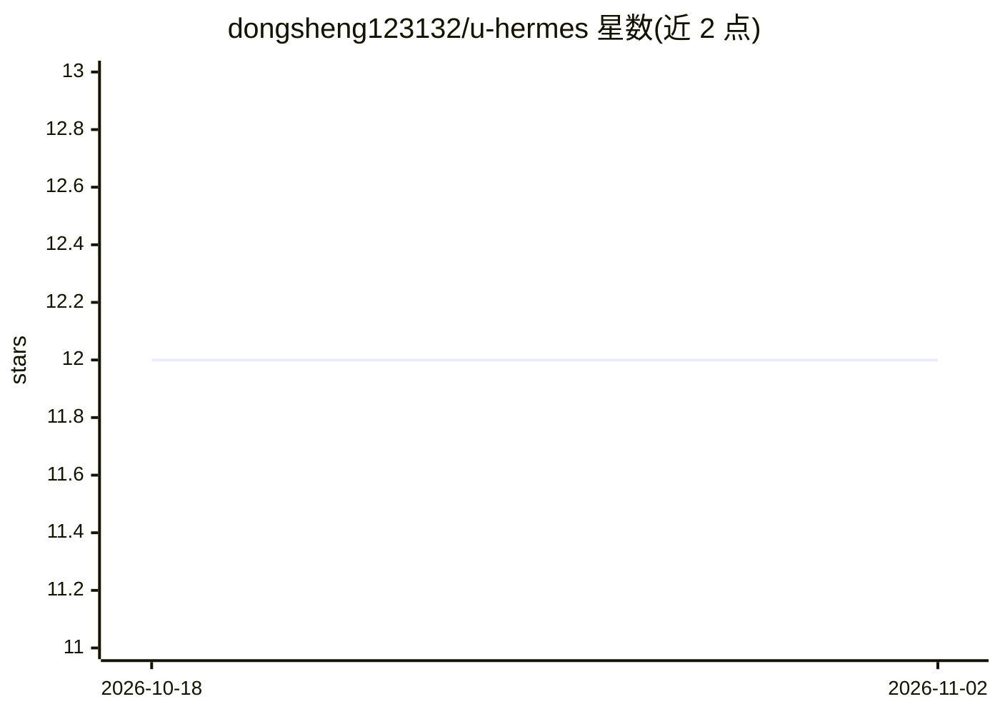

# dongsheng123132/u-hermes

⭐ 12 · HTML · 推送 2026-11-01 · [GitHub](https://github.com/dongsheng123132/u-hermes) · [官网](https://www.u-hermes.org/) · 个人维护 · 中文 README

**便携 AI 编程 Agent U 盘：Windows 成品与开源 Linux Live 启动盘方案**

基于 NousResearch hermes-agent 打包的便携 AI Agent 环境分发项目：商业版为 Windows 便携 U 盘，内置 U-Claw（通用 AI + IM 机器人）与 U-Hermes（编程 Agent），带 Electron 图形启动器与账户激活体系，¥199 起售；开源部分仅含官网源码、Linux Live USB 刻盘脚本与文档，可自行刻盘搭建，但缺少 U-Claw 集成、图形启动器与一键化体验。关键词提及 DeepSeek、通义千问、ollama 等模型来源。

## 筛选速览

| 维度 | 判定 | 备注 |
|---|---|---|
| AI 角色 | `ai-native` | 本体是模型或模型工具 |
| 许可风险 | `none` | — |
| 部署形态 | `desktop` | 安装包/桌面程序 |
| 模型依赖 | — | README 未给出锁定关系 |
| 硬件要求 | — | 无带数字的原话,不猜 |
| 安装摩擦 | `low` | 无编译、无系统依赖或容器化 |
| 成熟度 | — | 结构信号不足 |

## 能力要点

- 同一 U 盘内置 U-Claw 与 U-Hermes 双产品，Windows 成品免安装即用
- 开源 Linux Live USB 四步刻盘脚本（PowerShell）
- 支持离线使用，随身携带 AI Agent 工作环境
- 代码 MIT，品牌商标保留

## 适用场景

- 随身携带可离线使用的 AI 编程 Agent 环境
- 用开源脚本自制 Linux Live AI 启动盘
- 不想折腾的 Windows 用户购买成品 U 盘开箱即用

## 场景标签

`编码 Agent` · 领域:编码与开发

## 证据(README 行号)

> L5: U-Hermes 马盘是即插即用的 AI U 盘成品：同一张 Windows 便携 U 盘内置 U-Claw（通用 AI + IM 机器人）和 U-Hermes（编程 Agent）。U-Hermes 基于 Nous Research
> L14: |**U-Hermes 马盘 Windows 便携 U 盘**|成品 U 盘开箱即用，内置 U-Claw + U-Hermes|¥199 起 / 淘宝 / 拼多多|所有 Windows 用户|

## 星数曲线

2026-10-18 12 → 2026-11-02 12（+0）

---
*卡片 v1 · prompt 1.4 · 生成 2026-11-01 · 置信度 high · 依据 README sha `1d6cdd617f54` · [字段定义](../../DATASET.md)*
