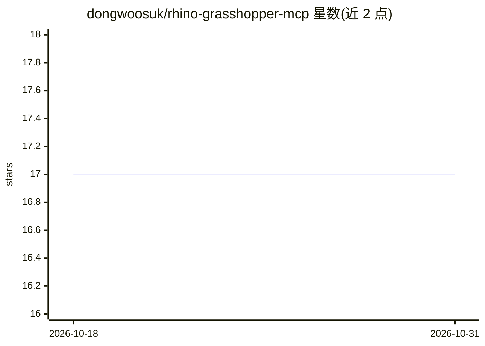

# dongwoosuk/rhino-grasshopper-mcp

⭐ 17 · Python · MIT · 推送 2026-05-27 · [GitHub](https://github.com/dongwoosuk/rhino-grasshopper-mcp) · 个人维护

**连接 Rhino/Grasshopper 的 MCP 服务器，带 ML 自动布局**

面向 Rhino/Grasshopper 计算性设计用户的 MCP（Model Context Protocol）服务器，供 Claude 等客户端通过工具调用接入实时运行中的 Rhino：远程执行 Python、读取画布状态、触发求解、解析 .gh/.ghx 文件、搜索 500+ 组件库并生成 GHPython/C# 脚本模板。内含基于 scikit-learn 的 ML 布局系统（DBSCAN/K-means 聚类、K-NN 位置预测、连线交叉最小化、用户偏好学习）与 AI 辅导功能（性能预测、低效模式检测、自动分组）。通过 git clone 加 pip 安装，需 Python 3.10+；实时连接需在 Rhino 7/8 内手动启动监听脚本。

## 筛选速览

| 维度 | 判定 | 备注 |
|---|---|---|
| AI 角色 | `ai-ecosystem` | LLM/agent 周边工具 |
| 许可风险 | `permissive` | MIT |
| 部署形态 | `library` | 以包/库形式分发 |
| 模型依赖 | — | README 未给出锁定关系 |
| 硬件要求 | — | 无带数字的原话,不猜 |
| 安装摩擦 | `low` | 无编译、无系统依赖或容器化 |
| 成熟度 | — | 结构信号不足 |

## 能力要点

- MCP 工具接入实时 Rhino 实例：远程执行 Python、读取画布、触发求解
- ML 布局系统：DBSCAN/K-means 聚类、K-NN 位置预测、连线交叉最小化
- AI 辅导：性能预测、低效模式检测（如多重 Move 建议改用 Transform Matrix）
- 可搜索的 500+ Grasshopper 组件数据库与 GHPython/C# 模板生成

## 适用场景

- 让 Claude 等 MCP 客户端直接操作我正在用的 Grasshopper 画布
- 自动整理杂乱的 Grasshopper 定义布局
- 审查定义并获得优化建议与最佳实践辅导

## 场景标签

`代码生成` · 领域:编码与开发

## 证据(README 行号)

> L3: An MCP (Model Context Protocol) server that brings AI capabilities directly into Rhino/Grasshopper workflows, featur
> L56: Add to your `claude_desktop_config.json`:
> L111: │   ├── bridge.py              # Main MCP server

## 星数曲线

2026-10-18 17 → 2026-10-31 17（+0）

---
*卡片 v1 · prompt 1.4 · 生成 2026-10-29 · 置信度 high · 依据 README sha `19c424e6866d` · [字段定义](../../DATASET.md)*
