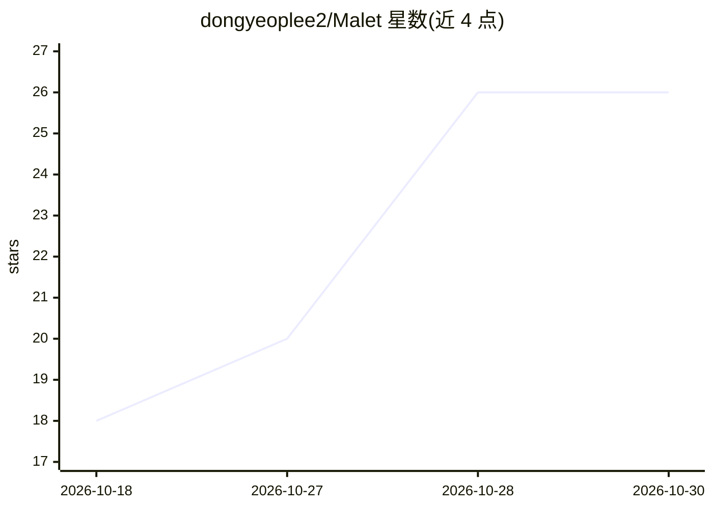

# dongyeoplee2/Malet

⭐ 26 · Python · MIT · 推送 2026-04-19 · [GitHub](https://github.com/dongyeoplee2/Malet) · [官网](https://dongyeoplee2.github.io/Malet/) · 个人维护

**个人研究用机器学习实验工具：超参网格搜索与可视化**

面向个人研究的机器学习实验管理 Python 工具：通过 yaml 配置中的 grid 关键字声明参数取值列表，自动运行全部组合；结果以 log.tsv 记录，可通过 ExperimentLog 在 Python 中读取，支持任务中断后从最近配置恢复。提供 malet-plot 命令行工具，基于日志生成 curve/bar/heatmap/scatter 等多种图表，并支持多 GPU 并行搜索与 checkpoint。作者声明这是个人宠物项目，尚不稳定。

## 筛选速览

| 维度 | 判定 | 备注 |
|---|---|---|
| AI 角色 | `ai-ecosystem` | LLM/agent 周边工具 |
| 许可风险 | `permissive` | MIT |
| 部署形态 | `library` | 以包/库形式分发 |
| 模型依赖 | — | README 未给出锁定关系 |
| 硬件要求 | — | 无带数字的原话,不猜 |
| 安装摩擦 | `low` | 无编译、无系统依赖或容器化 |
| 成熟度 | `idea` | |

## 能力要点

- yaml 配置中 grid 关键字声明超参网格，自动运行全部组合
- 实验日志自动保存为 log.tsv，支持中断后恢复
- malet-plot CLI 生成 curve/bar/heatmap/scatter 等 6 种图表模式
- 支持多 GPU 并行搜索

## 适用场景

- 为已有训练管线做多组超参网格实验并自动记录指标
- 实验被中断后从最近运行的配置继续
- 基于实验日志批量绘制训练曲线与超参热图

## 场景标签

`MLOps` · 领域:训练与推理

## 证据(README 行号)

> L7: **Malet** (short for **Ma**chine **L**earning **E**xperiment **T**ool) is a tool for hyperparameter grid searches, m
> L30: - 🔎 Easy & powerful hyperparameter grid search syntax

## 星数曲线

2026-10-18 18 → 2026-10-30 26（+8）

---
*卡片 v1 · prompt 1.4 · 生成 2026-10-28 · 置信度 high · 依据 README sha `467396c28604` · [字段定义](../../DATASET.md)*
