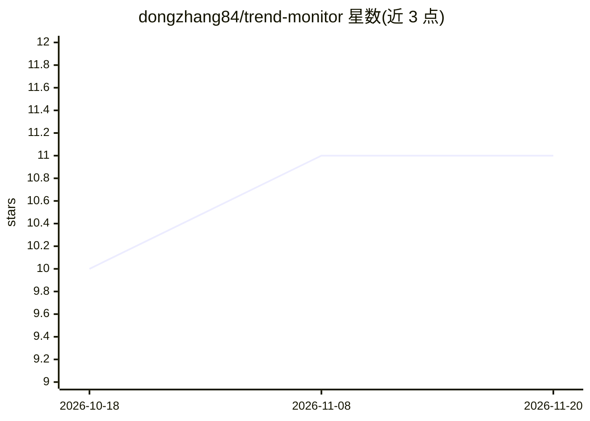

# dongzhang84/trend-monitor

⭐ 11 · Python · 推送 2026-11-18 · [GitHub](https://github.com/dongzhang84/trend-monitor) · 个人维护

**聚合 6 个来源的每日/每周 AI 技术趋势监控工具**

Python 编写的趋势监控工具：每日从 Product Hunt、Toolify.ai、There's An AI For That、Chrome 扩展、GitHub Trending、Hacker News 六个来源采集数据，生成 Markdown 报告与双 HTML 仪表盘（GitHub Pages 托管），并通过 Gmail SMTP 发送邮件；每周日自动生成含关键词与重复项分析的周报。附带面向独立开发者的机会分析：过滤 B2B 与机构类产品后按四维评分，前 5 名给出 8 问题深挖。依赖 GitHub Actions 定时运行，需配置 Gmail 应用密码。

## 筛选速览

| 维度 | 判定 | 备注 |
|---|---|---|
| AI 角色 | `ai-enhanced` | 去掉 AI 部分产品仍成立 |
| 许可风险 | `permissive` | — |
| 部署形态 | `library` | 以包/库形式分发 |
| 模型依赖 | — | README 未给出锁定关系 |
| 硬件要求 | — | 无带数字的原话,不猜 |
| 安装摩擦 | `low` | 无编译、无系统依赖或容器化 |
| 成熟度 | — | 结构信号不足 |

## 能力要点

- 聚合 6 个数据源的每日/每周自动化报告
- GitHub Actions 定时执行并自动部署到 GitHub Pages
- 独立开发者机会评分（4 维度）与前 5 名 8 问题深挖
- Playwright 渲染绕过 Cloudflare 采集 Toolify 数据

## 适用场景

- 每天早上在邮箱收到 AI 产品趋势摘要
- 为独立开发筛选可复刻的产品机会
- 跟踪一周内反复出现的产品与热门关键词

## 场景标签

`网页抓取` · 领域:效率与自动化

## 证据(README 行号)

> L6: Daily business opportunity discovery tool - monitors AI products and trending tools from 6 sources. Get a curated di
> L22: - **Multi-source Aggregation** - Collects data from 6 sources: Product Hunt, Toolify.ai, There's An AI For That, Ch
> L219: Every daily run generates `analysis/daily/{date}-indie.md` — a report designed for solo builders evaluating whethe

## 星数曲线

2026-10-18 10 → 2026-11-20 11（+1）

---
*卡片 v1 · prompt 1.4 · 生成 2026-11-18 · 置信度 low · 依据 README sha `4dd0564d3af5` · [字段定义](../../DATASET.md)*
