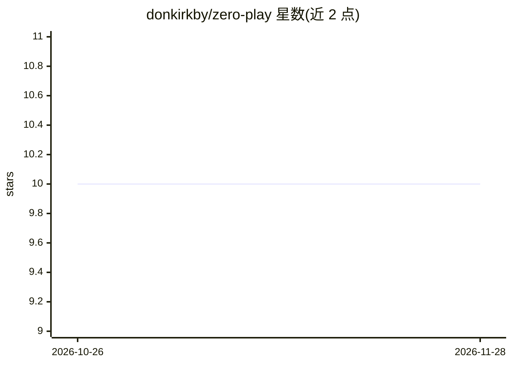

# donkirkby/zero-play

⭐ 10 · Python · MIT · 推送 2026-11-18 · [GitHub](https://github.com/donkirkby/zero-play) · [官网](https://donkirkby.github.io/zero-play/) · 个人维护

**供开发者训练任意棋盘游戏 AI 对手的 Python 库**

基于 AlphaGo Zero 论文思路与 alpha-zero-general 示例代码的可复用 Python 库，供其他项目在此基础上为多种棋盘游戏构建计算机对手；示例项目 Shibumi Games 使用该库。提供图形界面，可与计算机对手或他人对弈；以常规 Python 包通过 pip 安装，安装后有 zero_play 命令入口，Ubuntu 20.04 存在 PySide 的 Qt 平台插件问题需安装 libxcb-xinerama0 规避。

## 筛选速览

| 维度 | 判定 | 备注 |
|---|---|---|
| AI 角色 | `ai-native` | 本体是模型或模型工具 |
| 许可风险 | `permissive` | MIT |
| 部署形态 | `library` | 以包/库形式分发 |
| 模型依赖 | — | README 未给出锁定关系 |
| 硬件要求 | — | 无带数字的原话,不猜 |
| 安装摩擦 | `low` | 无编译、无系统依赖或容器化 |
| 成熟度 | — | 结构信号不足 |

## 能力要点

- 基于 AlphaGo Zero 论文思路实现
- 以 Python 库形式供其他项目复用扩展
- 内置图形界面，可人机或人人对弈

## 适用场景

- 为棋盘游戏训练计算机对手
- 在自己的 Python 项目中引入游戏 AI 能力
- 通过图形界面与训练出的 AI 对弈

## 场景标签

`强化学习` `模型训练` · 领域:训练与推理

## 证据(README 行号)

> L4: The zero play library is based on the ideas in the [AlphaGo Zero paper] and the
> L6: project is to make a reusable Python library that other projects can build on
> L16: Even though Zero Play has a graphical display, it is a regular Python package,

## 星数曲线

2026-10-26 10 → 2026-11-28 10（+0）

---
*卡片 v1 · prompt 1.4 · 生成 2026-11-19 · 置信度 high · 依据 README sha `1543f22fdc03` · [字段定义](../../DATASET.md)*
